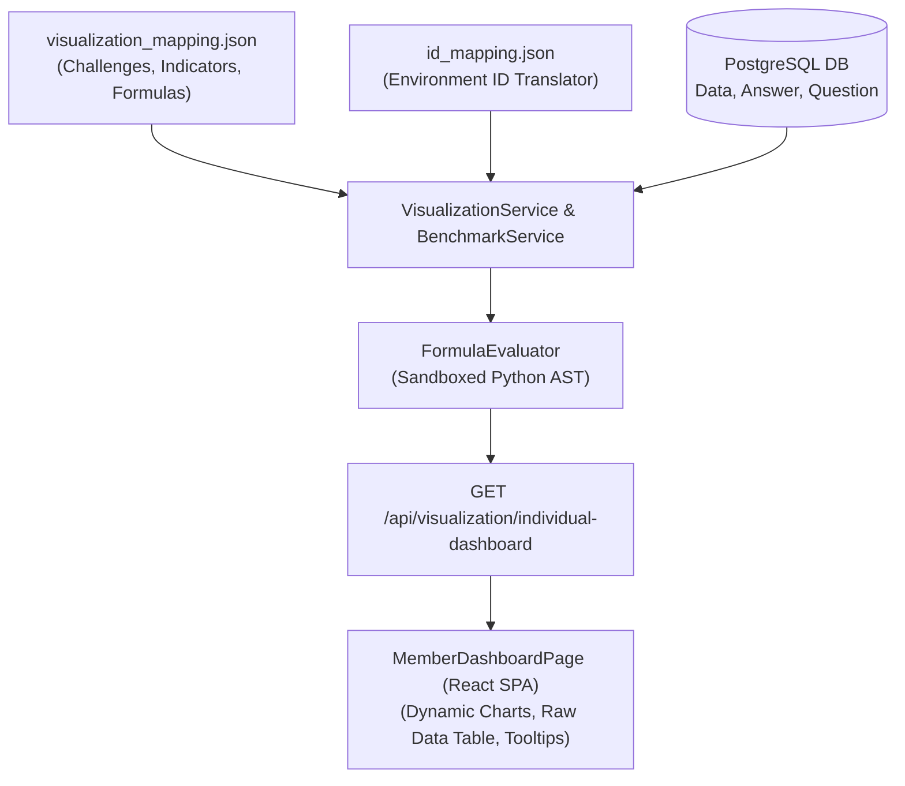

# Visualization Configuration & Formula Engine Guide

> **Authoritative Reference for the Member Reporting Back Dashboard**  
> **Target Audience**: Backend Developers, DevOps, Data Analysts, and Secretariat Administrators.  
> **Primary Config Path**: [`backend/source/config/visualization_mapping.json`](/backend/source/config/visualization_mapping.json)

---

## 1. Architecture Overview

The Member Reporting Back Dashboard is driven by a **purely declarative, zero-code-change architecture**. All challenges, indicators, aggregation formulas, chart structures, tooltips, and benchmark controls are defined in `visualization_mapping.json`.



### Key Principles:
1. **Decoupled from Frontend**: The React frontend (`MemberDashboardPage.jsx`) consumes the API dynamically. Adding, removing, or re-ordering indicators in `visualization_mapping.json` updates the frontend visual charts and Raw Data Table automatically without frontend code changes or rebuilds.
2. **Safe Mathematical Evaluation**: Formulas are evaluated using a sandboxed Python Abstract Syntax Tree (`ast`) engine (`FormulaEvaluator`). Arbitrary code execution (`eval`) is strictly prohibited.
3. **Environment Portability**: Question IDs in the configuration reference canonical Production IDs. The `id_mapping.json` resolver automatically translates them to local or test database IDs, ensuring the exact same config works across Local, Staging, and Production environments.

---

## 2. Configuration File Structure

The configuration file is formatted as JSON and adheres to the following top-level structure:

```json
{
  "start_year": 2022,
  "end_year": null,
  "exclude_current_member_from_average": false,
  "enable_peer_group_filter": true,
  "challenges": [
    {
      "id": "transparency_and_traceability",
      "name": "Transparency and traceability",
      "indicators": [ ... ]
    }
  ]
}
```

### 2.1 Top-Level Global Settings

| Field | Type | Default | Description |
| :--- | :--- | :--- | :--- |
| `start_year` | `integer` | `2022` | Earliest year displayed on chart axes and included in historical benchmark aggregations. |
| `end_year` | `integer` or `null` | `null` | Latest year displayed. If `null`, dynamically resolves to the current calendar year (`datetime.now().year`). |
| `exclude_current_member_from_average` | `boolean` | `false` | When `true`, the viewing member's own responses are omitted from the ISCO/GISCO baseline average calculations. |
| `enable_peer_group_filter` | `boolean` | `true` | When `true`, enables peer group benchmark filtering in the API and renders the Peer Group selector in the UI. |
| `challenges` | `array[object]` | `[...]` | List of challenge groups containing active indicators. |

---

## 3. Challenge & Indicator Schema

### 3.1 Challenge Group Object

| Field | Type | Example | Description |
| :--- | :--- | :--- | :--- |
| `id` | `string` | `"agroforestry_and_deforestation"` | Unique identifier used for DOM anchors, tabs, and localization lookups. |
| `name` | `string` | `"Agroforestry & Deforestation-free cocoa"` | Human-readable title displayed as the challenge section header. |
| `indicators` | `array[object]` | `[...]` | Array of indicator configurations under this challenge. |

### 3.2 Indicator Object Schema

```json
{
  "id": "cocoa_agroforestry_systems",
  "name": "Share of cocoa sourced from agroforestry systems",
  "country": "Global",
  "description": "Lorem ipsum dolor sit amet...",
  "translations": [
    { "language": "de", "description": "Lorem ipsum dolor sit amet (de)..." },
    { "language": "fr", "description": "Lorem ipsum dolor sit amet (fr)..." }
  ],
  "form_id": 7,
  "question_group": {
    "id": 121,
    "name": "Agroforestry & Environmental Sourcing"
  },
  "formula": "SUM_PRODUCT(ID878, ID1229) / ID1288",
  "numerator_ids": [878, 1229],
  "denominator_ids": [1288],
  "type": "percentage",
  "chart_type": "line",
  "higher_is_better": true,
  "aggregate_repeats": true,
  "year_index_question": null
}
```

#### Detailed Attribute Reference:

| Attribute | Type | Required | Description |
| :--- | :--- | :---: | :--- |
| `id` | `string` | **Yes** | Unique snake_case indicator key (e.g., `sourced_directly`). Used as chart series key and frontend translation key in `ui-text.js`. |
| `name` | `string` | **Yes** | Default English title displayed in chart cards and raw data headers. |
| `country` | `string` | **Yes** | Geographical scope badge shown on the chart card (e.g. `"Global"`, `"West Africa (Cameroon, Côte d'Ivoire, Ghana, Nigeria)"`). |
| `description` | `string` | **Yes** | Default English explanatory text rendered in the Info icon popover/tooltip. |
| `translations` | `array[object]` | No | Optional translations for the info popover: `[{"language": "de", "description": "..."}]`. |
| `form_id` | `integer` | **Yes** | The survey form ID where the questions reside (typically `7` for Member Reporting). |
| `question_group` | `object` | **Yes** | Object with `id` (`int`/`string`) and `name` (`string`) for grouping rows in the Raw Data Table. |
| `formula` | `string` | **Yes** | Mathematical AST formula string evaluated by `FormulaEvaluator` (see Section 4). |
| `numerator_ids` | `array[int]` | **Yes** | Question IDs retrieved as numerator inputs for the formula and Raw Data Table. |
| `denominator_ids` | `array[int]` | **Yes** | Question IDs retrieved as denominator inputs (empty array `[]` if none). |
| `type` | `string` | **Yes** | `"percentage"` or `"ratio"`. Ratios are automatically formatted as percentages (`value * 100`) on UI axes. |
| `chart_type` | `string` | **Yes** | Visual representation type (default `"line"`). |
| `higher_is_better` | `boolean` | **Yes** | Polarity indicator (`true` = higher value is desirable; `false` = lower is better, e.g., child labour cases). |
| `aggregate_repeats`| `boolean` | No | Flag indicating that answers come from repeating groups and should be returned as aligned lists. |
| `year_index_question`| `integer` | No | Optional Question ID (e.g., `1215`). When present, the evaluated metric is indexed by the study/collection year answered in this question instead of the survey submission year (`Data.submitted`). |
| `calculation_type` | `string` | No | Metadata label for specialized calculations (e.g., `"weighted_repeat"`). |
| `weight_id` / `value_id` / `scale_id` | `integer` | No | Declarative metadata for question roles in weighted calculations. |

---

## 4. Formula Engine & Syntax (`FormulaEvaluator`)

The formula engine translates the string in the `"formula"` field into an Abstract Syntax Tree using Python's `ast.parse` in `ast.PyCF_ONLY_AST` mode.

### 4.1 Referencing Questions
Questions are referenced by prefixing the question ID with `ID`, case-insensitively:
- `ID86` ➔ Evaluates the answer for Question 86.
- `ID840 + ID841` ➔ Sums answers for Question 840 and Question 841.
- `(ID840 + ID841) / ID842` ➔ Grouping via standard parentheses.

### 4.2 Standard Mathematical Operators
- `+` : Addition
- `-` : Subtraction
- `*` : Multiplication
- `/` : Division (with zero-division protection returning `null` / `None`)

### 4.3 Supported Mathematical & Statistical Functions

| Function | Signature | Description & Example |
| :--- | :--- | :--- |
| **`SUM`** | `SUM(arg1, [arg2, ...])` | Sums scalar values or sums all values in a repeat group list.<br>`SUM(ID1289) / ID1288` |
| **`SUM_PRODUCT`** | `SUM_PRODUCT(weights, values)` | Computes the dot product \(\sum (w_i \times v_i)\) over paired repeat group vectors.<br>`SUM_PRODUCT(ID878, ID1229) / ID1288` |
| **`WEIGHTED_AVG`** | `WEIGHTED_AVG(weights, values)` | Computes \(\frac{\sum (w_i \times v_i)}{\sum w_i}\) over paired vectors.<br>`WEIGHTED_AVG(ID878, ID1229)` |
| **`AVG`** | `AVG(arg1, [arg2, ...])` | Arithmetic average of arguments or list items.<br>`AVG(ID10, ID20, ID30)` |
| **`MEDIAN`** | `MEDIAN(arg1, [arg2, ...])` | Statistical median over arguments or list items.<br>`MEDIAN(ID10, ID20, ID30)` |
| **`COUNT`** | `COUNT(arg1, [arg2, ...])` | Counts number of non-null numeric entries.<br>`COUNT(ID10, ID20)` |
| **`MIN`** | `MIN(arg1, [arg2, ...])` | Minimum value.<br>`MIN(ID10, ID20)` |
| **`MAX`** | `MAX(arg1, [arg2, ...])` | Maximum value.<br>`MAX(ID10, ID20)` |
| **`ROUND`** | `ROUND(value, [decimals])` | Rounds `value` to `decimals` places (default 0).<br>`ROUND(ID10 / ID20, 2)` |
| **`ABS`** | `ABS(value)` | Absolute value.<br>`ABS(ID10 - ID20)` |
| **`CLAMP`** | `CLAMP(value, min, max)` | Constrains `value` to the range `[min, max]`.<br>`CLAMP(ID10, 0, 100)` |
| **`SAFE_DIV`** | `SAFE_DIV(num, denom, [fallback])` | Safe division returning `fallback` (default `0.0`) if denominator is 0.<br>`SAFE_DIV(ID10, ID20, 0.0)` |
| **`COALESCE`** | `COALESCE(arg1, arg2, ...)` | Returns the first non-null argument.<br>`COALESCE(ID10, ID20, 0)` |

---

## 5. Repeating Groups & Vector Alignment

When an indicator performs calculations over repeating groups (e.g., supplier lists, country breakdowns):
1. **Repeat Vector Ordering**:
   The backend services (`VisualizationService` and `BenchmarkService`) strictly order repeat answers by:
   ```sql
   ORDER BY answer.repeat_index ASC, answer.id ASC
   ```
2. **Pairing**:
   When evaluating `SUM_PRODUCT(ID878, ID1229)`, element `ID878[0]` is multiplied with `ID1229[0]`, `ID878[1]` with `ID1229[1]`, etc.
3. **Mismatched Lengths**:
   If one vector is shorter, evaluation truncates safely to the common length without throwing errors. Missing or non-numeric answers inside vectors are skipped.

---

## 6. Study Year Remapping (`year_index_question`)

Certain survey questions capture multi-year studies conducted in previous years (e.g., Living Income Benchmark Studies):
- In normal indicators, data points are bucketed by the survey submission year (`Data.submitted.year`).
- When `"year_index_question": 1215` is declared:
  1. The engine checks the member's numeric answer for Question `1215`.
  2. If Question `1215` contains `2021`, the computed metric (`ID950 / ID845`) is assigned to year **2021** on the chart, even if the survey was submitted in **2023**.

---

## 7. How to Add a New Indicator (Step-by-Step)

Follow this 5-step checklist whenever stakeholders add or update a chart indicator:

### Step 1: Gather Requirements
Obtain the following from the survey definition / Excel specification:
- **Challenge group** (e.g. `agroforestry_and_deforestation`).
- **Indicator ID & Name** (e.g. `agroforestry_shade_trees`).
- **Question IDs** for numerators, denominators, weights, or year indexes.
- **Aggregation Formula** (e.g. `SUM(ID123) / ID456`).

### Step 2: Edit `visualization_mapping.json`
Add the indicator object to the desired challenge in `backend/source/config/visualization_mapping.json`:
```json
{
  "id": "agroforestry_shade_trees",
  "name": "Share of farms with minimum 16 shade trees per hectare",
  "country": "Global",
  "description": "Explains shade tree density monitoring per hectare.",
  "translations": [
    {
      "language": "de",
      "description": "Erklärt die Überwachung der Schattbaumdichte pro Hektar."
    }
  ],
  "form_id": 7,
  "question_group": {
    "id": 121,
    "name": "Agroforestry & Environmental Sourcing"
  },
  "formula": "ID1400 / ID842",
  "numerator_ids": [1400],
  "denominator_ids": [842],
  "type": "percentage",
  "chart_type": "line",
  "higher_is_better": true
}
```

### Step 3: Check Environment Portability (`id_mapping.json`)
If the local Docker or Staging database has different question IDs than Production:
1. Open `backend/source/config/id_mapping.json`.
2. Ensure the production question ID (e.g. `1400`) maps to the corresponding local question ID:
   ```json
   "1400": 82
   ```

### Step 4: (Optional) Frontend German Translations
The frontend automatically renders the English name from the JSON config. If German translations are required:
1. Open `frontend/src/static/ui-text.js`.
2. Add translation entries under `individualDashboard.indicatorTitles.de`:
   ```javascript
   agroforestry_shade_trees: "Anteil der Betriebe mit mindestens 16 Schattenbäumen pro Hektar",
   ```

### Step 5: Test & Verify
Run the automated formula and visualization test suites inside Docker:
```bash
./dc.sh exec backend sh -c "/usr/local/bin/pytest tests/test_formula_evaluator.py tests/test_visualization.py"
```

---

## 8. Troubleshooting & FAQ

### Q1: The chart shows `null` or no line for an indicator.
- **Cause**: The member has not answered the required questions for that year, or the denominator evaluated to `0.0`.
- **Behavior**: The engine safely outputs `null` rather than a 500 server error. The line chart will show gaps or omission for that year.

### Q2: Do I need to redeploy the frontend when modifying formulas or adding indicators?
- **No.** The frontend React application fetches `/api/visualization/individual-dashboard`, which dynamically enumerates all challenges and indicators returned by the backend. New indicators appear automatically.

### Q3: How do I test a formula in isolation?
Use the interactive Python shell or write a unit test in `backend/tests/test_formula_evaluator.py`:
```python
from services.formula_evaluator import FormulaEvaluator

evaluator = FormulaEvaluator()
result = evaluator.evaluate("SUM_PRODUCT(ID1, ID2) / ID3", {
    1: [10.0, 20.0],
    2: [0.5, 0.8],
    3: 100.0
})
# Expected: (10*0.5 + 20*0.8) / 100 = 21.0 / 100 = 0.21
```
