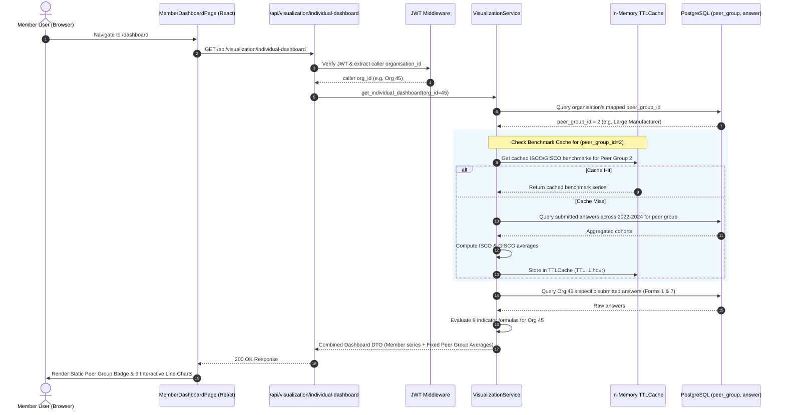

# Feature Specification: Member Reporting Back Dashboard ("Dashboard Member X")

> **Document Type**: Feature Specification (Updated per Stakeholder Feedback)  
> **Status**: `Ready for Approval` | **Author**: Tech Lead (`bmad-architect`)  
> **Scope**: **"Dashboard Member X" sheet** (Multi-Year Trend Dashboard: 9 Interactive Line Charts & Fixed Peer Group Benchmark)  
> **Reference HLD**: [docs/hld/member_dashboard_hld.md](docs/hld/member_dashboard_hld.md)  
> **Reference LLD**: [docs/lld/member_dashboard_lld.md](docs/lld/member_dashboard_lld.md)  

---

## 1. Feature Overview & Requirements Discovery (5W1H)

### Stakeholder Feedback & Change Summary
1. **Peer Group Benchmarking**:
   - The interactive dropdown allowing members to switch peer groups (`Trader/Processor`, `Large Manufacturer`, `SME`, `Retail`) has been **removed**.
   - Members **can only see their performance against their own assigned peer group** (automatically resolved from the member organisation's `member_type`).
   - Secretariat Admins (`secretariat_admin`) retain the ability to switch between member organisations (`?organisation_id={id}`), which automatically loads that specific organisation's peer group benchmark lines.
2. **Configurable Exclusion of Current Member from Averages**:
   - Awaiting GISCO decision on whether the active member organization should be excluded from the peer group average calculation (e.g. self-exclusion vs full cohort average).
   - **Architectural Solution**: Implement a declarative toggle `exclude_current_member_from_average` (default `false`) configurable via `/backend/source/config/visualization_mapping.json` (and overrideable via `.env` / runtime setting).
   - When `false`, the benchmark is the true global cohort average (all peer members including self).
   - When `true`, the benchmark dynamically excludes the current organization's submitted answers from the numerator and denominator, preventing large members from heavily skewing the peer benchmark curve against which they are compared.
3. **Declarative Configuration (`visualization_mapping.json`)**:
   - Added `chart_type` attribute to every indicator definition (defaulting to `"line"` for this year's indicators, with extensible forward-compatible support for `"bar"`, `"stacked_bar"`, etc.).
4. **Formula Capability Architecture**:
   - Clarified and standardized formula evaluation capability: safe Python AST parser supports both simple arithmetic (`+`, `-`, `*`, `/`) and complex permutations (parentheses grouping `(A + B) / C`, conditional fallback `coalesce(...)`, aggregation functions like `SUM(...)`, and statistical functions like `AVG(...)`, `MIN(...)`, `MAX(...)`). Evaluated securely without dangerous `eval()`.

### 5W1H Framework
- **Who**: Member Users & Member Admins (`member_user`, `member_admin`), Secretariat Admins (`secretariat_admin`).
- **What**: Multi-year trend dashboard digitizing the "Dashboard Member X" sheet from `5_Template DUMMY_Individual_reporting_back_ISCO_GISCO.xlsx`. Displays 9 interactive time-series line charts across 4 sustainability challenges (Transparency, Deforestation, Living Income, Child Labour), comparing individual performance (2022–2024) against ISCO and GISCO averages for their assigned peer group.
- **Where**:
  - **Frontend**: `/dashboard` route (`/frontend/src/pages/member-dashboard/MemberDashboardPage.jsx`).
  - **Backend**: `/backend/routes/visualization.py` (`GET /api/visualization/individual-dashboard`).
  - **Database**: PostgreSQL tables `peer_group`, `peer_group_member_type`, linking to `organisation` via `member_type`.
- **When**: Delivered within the current sprint cycle.
- **Why**: Members need an immediate, self-serve visual benchmark of their progress over time relative to their direct peers without manual Excel report generation, while preventing cross-cohort comparison leakage.
- **How**: The backend looks up the member's mapped peer group from their authenticated organization session, computes/retrieves cached 3-year cohort benchmarks, and serves the series to Recharts multi-line charts.

---

## 2. Architecture & Data Flow



---

## 3. Touchpoint Files

| Operation | File Path | Purpose |
|---|---|---|
| `[CREATE]` | `/backend/models/peer_group.py` | SQLAlchemy models for `PeerGroup` and `PeerGroupMemberType`. |
| `[CREATE]` | `/backend/migrations/versions/YYYY-MM-DD_add_peer_group_tables.py` | Alembic migration creating tables and seeding 4 harmonized peer groups. |
| `[CREATE]` | `/backend/source/config/visualization_mapping.json` | Declarative mapping for the 9 indicators to survey questions and formulas. |
| `[CREATE]` | `/backend/services/visualization_service.py` | Calculation engine, AST formula evaluator, and TTLCache. |
| `[CREATE]` | `/backend/routes/visualization.py` | REST API endpoint `GET /api/visualization/individual-dashboard`. |
| `[CREATE]` | `/frontend/src/pages/member-dashboard/MemberDashboardPage.jsx` | Dashboard page shell displaying static peer group badge, org switcher (admins only), and 4 challenge sections. |
| `[CREATE]` | `/frontend/src/pages/member-dashboard/IndicatorLineChartCard.jsx` | Multi-line chart component using `akvo-charts` (`Line`) with compact yearly data table. |
| `[CREATE]` | `/backend/tests/test_visualization.py` | Pytest suite verifying formulas, peer group resolution, multi-tenant RBAC, and caching. |

---

## 4. Backend Implementation Specification

### 4.1 Database Models (`/backend/models/peer_group.py`)
```python
from sqlalchemy import Column, Integer, String, Text, ForeignKey, DateTime
from sqlalchemy.orm import relationship
from datetime import datetime
from db.connection import Base
from models.member_type import MemberType


class PeerGroup(Base):
    __tablename__ = "peer_group"

    id = Column(Integer, primary_key=True, index=True, autoincrement=True)
    name = Column(String, nullable=False)
    code = Column(String, unique=True, index=True, nullable=False)
    description = Column(Text, nullable=True)
    created = Column(DateTime, default=datetime.utcnow)

    member_types = relationship(
        "PeerGroupMemberType",
        backref="peer_group_detail",
        cascade="all, delete-orphan",
    )


class PeerGroupMemberType(Base):
    __tablename__ = "peer_group_member_type"

    id = Column(Integer, primary_key=True, index=True, autoincrement=True)
    peer_group_id = Column(Integer, ForeignKey("peer_group.id", ondelete="CASCADE"), nullable=False)
    member_type_id = Column(Integer, ForeignKey("member_type.id", ondelete="CASCADE"), nullable=False)
    isco_scope = Column(String, default="ALL", nullable=False)  # 'GISCO', 'ISCO', or 'ALL'

    member_type_detail = relationship(MemberType, backref="peer_group_associations")
```

### 4.2 Seed Data
The 4 harmonized peer groups mapped to existing `member_type` tags:
- `trader_processor`: Trader GISCO, FRISCO-trader, DISCO traders, Trader SWISSCO
- `large_manufacturer`: Industry, Big Industry, DISCO - Large Manufacturers
- `sme`: GISCO small industry, GISCO - Small Industry, SWISSCO SME, Small Industry, DISCO small manufacturers, Beyond Chocolate Small industry
- `retail`: Retail GISCO, Retail SWISSCO, Retail FRISCO, Retail DISCO, Retail BC, DISCO - Retail

### 4.3 API Endpoint Contract
#### `GET /api/visualization/individual-dashboard`
- **Query Parameters**:
  - `organisation_id` (optional, integer): Allowed **only** for `secretariat_admin`. For `member_user` / `member_admin`, this parameter is ignored or enforced to caller's org ID (prevents accessing other orgs' data).
  - Note: `peer_group_id` query parameter is **removed/ignored** because the peer group is resolved automatically from the target organization's `member_type`.
- **Response (`200 OK`)**:
  ```json
  {
    "organisation": {
      "id": 45,
      "name": "Chocolatier Example AG",
      "peer_group": {
        "id": 2,
        "code": "large_manufacturer",
        "name": "Large Manufacturer"
      }
    },
    "years": [2022, 2023, 2024],
    "challenges": [
      {
        "id": "transparency_and_traceability",
        "name": "Transparency and traceability",
        "indicators": [
          {
            "id": "sourced_directly",
            "name": "Share of cocoa sourced directly",
            "country": "Global",
            "unit": "percentage",
            "chart_type": "line",
            "higher_is_better": true,
            "series": [
              { "year": 2022, "member": 0.3422, "isco_avg": 0.3640, "gisco_avg": 0.3700 },
              { "year": 2023, "member": 0.7056, "isco_avg": 0.7000, "gisco_avg": 0.6500 },
              { "year": 2024, "member": 0.4854, "isco_avg": 0.4650, "gisco_avg": 0.4900 }
            ]
          }
        ]
      }
    ]
  }
  ```

### 4.4 Declarative Configuration & AST Formula Evaluator Capability
**File**: `/backend/source/config/visualization_mapping.json`

Every indicator definition includes:
- `chart_type`: `"line"` (Default for this release. Extensible to `"bar"`, `"stacked_bar"`, etc. for future cases).
- `formula`: The arithmetic expression or function.

#### Safe AST Formula Evaluator Capabilities:
The formula evaluator in `/backend/services/visualization_service.py` is built using Python's native `ast` (Abstract Syntax Tree) module with a whitelist of safe node types (`ast.BinOp`, `ast.UnaryOp`, `ast.Call`, `ast.Name`, `ast.Num`, `ast.Load`). This strictly prevents code injection while enabling rich mathematical expressions:
1. **Simple Arithmetic**: `+`, `-`, `*`, `/` (e.g. `ID840 + ID841`, `ID575 / ID842`).
2. **Arbitrary Parentheses & Groupings**: `(ID840 + ID841) / ID842` or `100 * (1 - (ID577 / ID873))`.
3. **Repeat Group Aggregations**: `SUM(ID1216) / ID842` (aggregates values across repeated survey rows or nested question groups).
4. **Statistical & Multi-Question Functions**:
   - `SUM(question_id, ...)`: Sums across repeating entries or multiple fields.
   - `AVG(question_id)`: Computes arithmetic mean across repeat entries.
   - `MIN(...)` / `MAX(...)`: Bounds clipping.
   - `COALESCE(ID1, ID2, default)`: Fallback prioritization (e.g. use secondary question if primary was skipped).
5. **Division-by-Zero & Missing Data Protection**:
   - If a denominator evaluates to `0` or data is missing, the evaluator returns `None` (`null` in JSON) instead of raising `ZeroDivisionError` or HTTP 500.

### 4.5 Configurable Exclusion of Current Member from Benchmark Averages
**Configuration Flag**: `exclude_current_member_from_average` (in `visualization_mapping.json` or environment variable `VISUALIZATION_EXCLUDE_CURRENT_MEMBER`, default: `false`).

- **Rationale**: Currently awaiting final confirmation from GISCO Secretariat on whether a member's own submitted values should be excluded when computing the peer group cohort averages (ISCO and GISCO averages).
- **Execution Mechanism in `VisualizationService`**:
  - When `exclude_current_member_from_average = false` (Standard Cohort Baseline):
    $$\text{Peer Average} = \frac{\sum_{i \in \text{Cohort}} \text{Value}_i}{N_{\text{Cohort}}}$$
  - When `exclude_current_member_from_average = true` (Exclusive Peer Baseline):
    $$\text{Peer Average}_{(\text{Org } k)} = \frac{\sum_{i \in \text{Cohort} \setminus \{k\}} \text{Value}_i}{N_{\text{Cohort}} - 1}$$
- **Caching Strategy**:
  - To maintain `< 50ms` response times while supporting dynamic member exclusion without recalculating the entire database cohort on every request, the aggregation engine caches the aggregated cohort sum ($\Sigma$) and count ($N$) per peer group/year in `TTLCache`.
  - When exclusion is enabled for Org $k$, the service performs an $O(1)$ subtraction:
    $$\text{Avg} = \frac{\Sigma_{\text{cached}} - \text{Value}_k}{N_{\text{cached}} - 1}$$
  - Enforces the minimum cohort threshold gate ($N \ge 3$ reporting members) before and after exclusion to preserve anonymization.


---

## 5. Frontend Implementation Specification

### 5.1 Page Shell (`MemberDashboardPage.jsx`)
- **Header Section**:
  - Displays title: `Individual Reporting Back Dashboard – {organisation.name}`.
  - Subtitle: `Overview of performance per challenge – Member vs {organisation.peer_group.name} average over time (2022 - 2024)`.
  - **Static Peer Group Tag/Badge**: Clearly displays the member's assigned peer group (e.g. Ant Design `<Tag color="blue">Peer Group: Large Manufacturer</Tag>`) instead of an interactive dropdown.
  - **Secretariat Switcher**: If logged in as `secretariat_admin`, show member organization dropdown switcher to inspect any member company.
- **Main Body**:
  - Renders 4 challenge sections, each containing 2-column responsive layout of `IndicatorLineChartCard`.
  - Handles loading skeleton and empty state alerts gracefully.

### 5.2 Chart Component (`IndicatorLineChartCard.jsx`)
- **Akvo Standard Visualizations (`akvo-charts`)**:
  - Replaces generic chart libraries with the official **`akvo-charts`** (`Line`) component (powered by Apache ECharts).
  - Imports: `import { Line } from 'akvo-charts'; import 'akvo-charts/dist/index.css';`.
  - Responsive container wrapping `<Line config={...} data={...} rawConfig={...} />`.
- **ECharts Configuration via `akvo-charts`**:
  - **Dataset / Data Format**: Normalized data matrix `[{ year: "2022", "Member": 34.2, "ISCO Avg": 36.4, "GISCO Avg": 37.0 }, ...]`.
  - **Color Palette & Stroke Styling**:
    - Member curve: Solid `#1890ff` (stroke 3px, circular symbol).
    - ISCO Average curve: Dashed `#fa8c16` (stroke 2px, type `'dashed'`).
    - GISCO Average curve: Dotted `#52c41a` (stroke 2px, type `'dotted'`).
  - **Toolbox & Tooltip**: Integrated hover tooltip displaying exact percentage values across the 3 series.
  - **Missing Years Handling**: `null` values natively supported by ECharts without broken line artifacts.
- **Compact Data Table**:
  - Positioned directly beneath each chart displaying exact numerical percentages for `Year`, `Member`, `ISCO Avg`, `GISCO Avg`.

---

## 6. Verification & Quality Gates

All tests executed via `./dc.sh`:
- **Backend Tests**: `./dc.sh exec backend pytest tests/test_visualization.py -v`
- **Lint Check**: `./dc.sh exec backend flake8`
- **Frontend Tests**: `./dc.sh exec frontend yarn test`
- **Frontend Lint**: `./dc.sh exec frontend yarn lint`
- **Coverage Gate**: `./dc.sh exec backend ./test.sh` (Must maintain ≥80% test coverage)

---

## 7. Vertical Slice Implementation Plan & Calibrated Estimation

By removing the dynamic client-side peer group switcher, we eliminate dynamic peer group switching state management, client recalculation triggers, and the separate `GET /api/visualization/peer-groups` dropdown endpoint.

### 7.1 Granular Task Estimation Breakdown (1 Dev @ 7 Hours/Day)

| Task ID | Task Description & Subtasks | Vibe Coding (Dev) | Automated Testing | Manual QA & Buffer | Total Buffered | Independent QA Verification Criteria |
| :--- | :--- | :---: | :---: | :---: | :---: | :--- |
| **TASK-01** | **Harmonized Peer Groups Database & Seeder**<br>• Create `peer_group` and `peer_group_member_type` SQLAlchemy models<br>• Write Alembic migration script creating tables and indexes<br>• Seed 4 harmonized peer groups linked to `member_type` tags<br>• Unit test migration upgrade/downgrade and tag mapping resolution | 3.0h | 1.5h | 2.0h | **6.5h (~0.9d)** | **Independent DB & Migration Gate**:<br>Run Alembic migration upgrade/downgrade; verify table structures and seed mappings in PostgreSQL. |
| **TASK-02** | **Declarative Indicator Config & AST Formula Evaluator**<br>• Author `/backend/source/config/visualization_mapping.json` for 9 indicators with `chart_type: "line"`<br>• Implement safe Python AST formula evaluator supporting arithmetic (`+`, `-`, `*`, `/`), groupings `(A + B) / C`, repeat sums (`SUM(ID1216) / ID842`), and custom permutations (`AVG`, `MIN`, `MAX`, `COALESCE`)<br>• Add division-by-zero & missing data safeguards (returns `null` without 500)<br>• Unit test evaluator against mock survey payloads across complex permutation edge cases | 3.5h | 2.0h | 2.0h | **7.5h (~1.1d)** | **Independent Engine Gate**:<br>Unit test suite verifies formulas with simple arithmetic, nested groupings, repeat aggregations, empty answers, missing years, and zero denominators. |
| **TASK-03** | **Peer Group Benchmark Aggregation & TTLCache**<br>• Query submitted answers for peer group member organisations across 2022–2024<br>• Calculate GISCO Average and ISCO Average benchmarks for the peer group cohort<br>• Implement configurable member self-exclusion toggle (`exclude_current_member_from_average`) with $O(1)$ cached cohort subtraction<br>• Enforce minimum cohort gate (>=3 reporting members per peer group/year to prevent de-anonymization)<br>• Build in-memory `TTLCache` (1-hour TTL) keyed by `peer_group_id`<br>• Integration tests verifying benchmark calculation & cache hits with and without member exclusion | 3.5h | 2.0h | 2.0h | **7.5h (~1.1d)** | **Independent Benchmarks Gate**:<br>Test script compares calculated ISCO/GISCO benchmarks against Excel dummy reference values under both `exclude_current_member=false` and `true`. |
| **TASK-04** | **Individual Dashboard REST API Endpoint & Multi-Tenant RBAC**<br>• Implement `GET /api/visualization/individual-dashboard`<br>• Enforce automatic peer group resolution from member's `member_type`<br>• Enforce data isolation: `member_user` can only query own organisation<br>• Allow `secretariat_admin` to pass `?organisation_id={id}`<br>• API integration tests verifying RBAC, 403 on foreign orgs, and payload contracts | 3.0h | 2.0h | 1.5h | **6.5h (~0.9d)** | **Independent API Gate**:<br>Swagger UI / curl testing: validates JSON structure, 403 on foreign org query attempt, and response times `< 50ms`. |
| **TASK-05** | **Frontend Dashboard Page Shell with Fixed Peer Group Badge**<br>• Create `/frontend/src/pages/member-dashboard/MemberDashboardPage.jsx`<br>• Add top header navigation link to `/dashboard`<br>• Render static Peer Group tag/badge based on API response<br>• Implement Secretariat Organisation Switcher for `secretariat_admin`<br>• Implement loading spinners, error alerts, and empty states | 2.5h | 1.5h | 1.5h | **5.5h (~0.8d)** | **Independent UI Shell Gate**:<br>Test `/dashboard` in browser: verify navigation, static peer group badge display, and Secretariat switcher. |
| **TASK-06** | **9 Multi-Line Charts via `akvo-charts` & Accompanying Data Grids**<br>• Install & verify `akvo-charts` dependency in frontend (`./dc.sh exec frontend yarn add akvo-charts`)<br>• Build `IndicatorLineChartCard.jsx` using `akvo-charts` `<Line>` component<br>• Configure 3 distinct ECharts curves: Member (solid blue), ISCO Avg (dashed orange), GISCO Avg (dotted green)<br>• Handle inverted polarity for child labour identification (lower is better visual cues)<br>• Handle missing years (`null` points) without chart breakdown<br>• Build compact yearly data table below each chart (`Year`, `Member`, `ISCO Avg`, `GISCO Avg`)<br>• Responsive 2-column grid layout across 4 Challenge sections | 4.5h | 2.0h | 2.5h | **9.0h (~1.3d)** | **Independent Chart Visual Gate**:<br>Verify all 9 charts in browser: inspect line styles, tooltips, missing year gaps, inverted polarity formatting, and data tables. |
| **TASK-07** | **E2E Integration, Docker Coverage Gate & Partner Review Buffer**<br>• Full regression run inside Docker (`./dc.sh exec backend ./test.sh`) enforcing **≥80% test coverage**<br>• Backend linting (`flake8`) and frontend linting/formatting (`yarn lint`, `yarn prettier-write`)<br>• Cross-browser testing (Chrome, Firefox, Safari) and responsive layout validation<br>• Walkthrough review demo with Joy Ghosh (Akvo) and Dr. Ulrike Joras (GISCO)<br>• Dedicated buffer for stakeholder adjustments | 2.5h | 1.5h | 5.5h | **9.5h (~1.4d)** | **Final Delivery Gate**:<br>Full `./dc.sh` regression passes (≥80% coverage), zero lint errors, stakeholder demo sign-off from Joy Ghosh and Dr. Ulrike Joras. |
| **TOTAL** | **Full Feature Delivery ("Dashboard Member X" Sheet)** | **22.5h** | **12.5h** | **17.0h** | **52.0h** | **~7.4 Working Days (1.5 Sprints / Weeks)** |

---

### 7.2 Comparison: Previous Scope vs. Updated Scope

| Metric | Previous Scope (Interactive Selector) | Updated Scope (Locked Peer Group) | Difference |
| :--- | :---: | :---: | :--- |
| **Peer Group Dropdown** | Interactive dropdown with dynamic recalculation | Static Badge/Tag displaying mapped peer group | -1 Endpoint, simplified UI |
| **Backend Endpoints** | 2 (`/individual-dashboard`, `/peer-groups`) | 1 (`/individual-dashboard`) | Reduced API surface |
| **Frontend State** | Controlled dropdown state + refetch trigger | Fixed fetch on load / org change | Eliminates refetch complexity |
| **Total Effort** | 56.0 hours (8.0 days) | **52.0 hours (~7.4 days)** | **-4.0 hours saved** |
