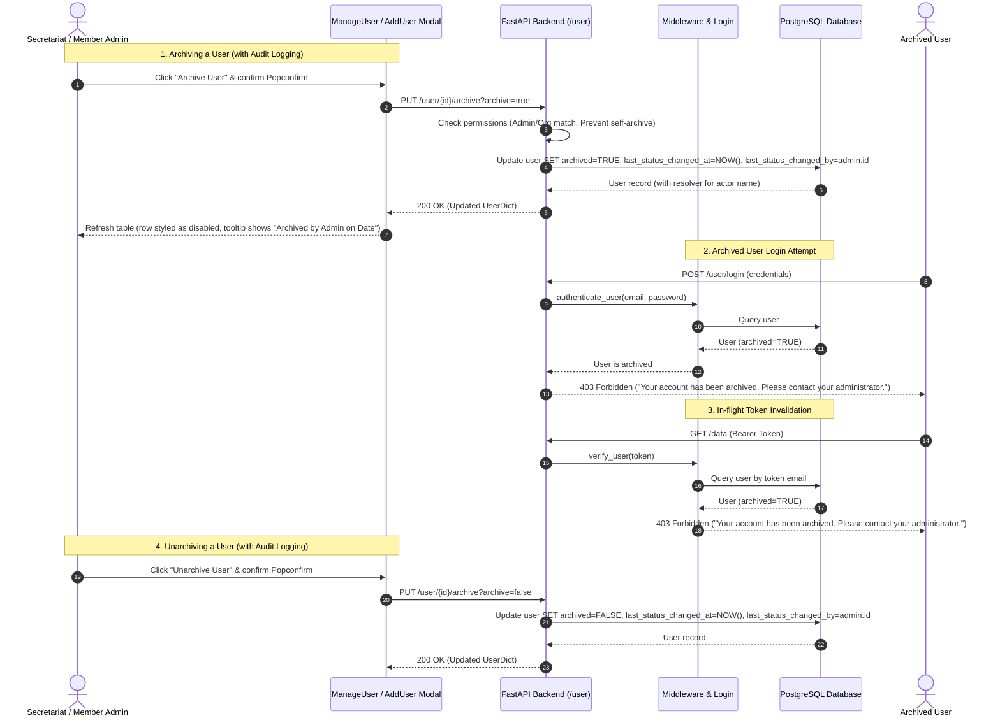

# Archive User Functionality - Implementation Plan

> **Specification Standard**:
> - **Path**: `docs/features/002_archive_user_spec.md`
> - **Project-Root-Relative Paths**: All references use `/backend/...` and `/frontend/...`.

---

## 5W1H Requirements Discovery

- **Who**: Secretariat Admins (`secretariat_admin`) and Member Admins (`member_admin`).
- **What**: Archive and unarchive users to control platform access. Archived users cannot log in, active tokens are blocked immediately via middleware, and their rows appear visually disabled in the user management table. Audit tracking records who performed the archive or unarchive action and when.
- **Where**:
  - Backend: `/backend/models/user.py`, `/backend/db/crud_user.py`, `/backend/middleware.py`, `/backend/routes/user.py`, Alembic migration.
  - Frontend: `/frontend/src/pages/manage-user/ManageUser.jsx`, `/frontend/src/pages/manage-user/AddUser.jsx`, `/frontend/src/pages/manage-user/style.scss`.
- **When**: Triggered when users leave member organisations or need access revoked while preserving historical submission records and audit trails.
- **Why**: Currently, departed users retain data access via their credentials because deletion is blocked when submissions exist. Archiving prevents unauthorized access without breaking database referential integrity or deleting historical records, with accountability for who changed account access.
- **How**:
  1. Add `archived` (Boolean), `last_status_changed_at` (DateTime), and `last_status_changed_by` (Integer FK to `user.id`) columns to the `user` table.
  2. Implement `PUT /user/{id}/archive` with authorization guards (super admin or member admin in same org; self-archiving blocked; records acting admin ID).
  3. Enforce access block in `/user/login` and `verify_user` (HTTP 403 Forbidden with descriptive message).
  4. Update `/user` endpoint and CRUD queries to support filtering by archive status and serialize the acting admin's name.
  5. Update `AddUser` modal with Archive / Unarchive Popconfirm actions, conditional field disablement, and an audit info banner showing who changed the status and when.
  6. Update `ManageUser` table with disabled row styling, "Archived" badge with audit tooltip (who and when), action button states, and "Include Archived" filter toggle.

---

## Architecture Overview



---

## 1. Backend Implementation

### 1.1 Database Model
**File**: `/backend/models/user.py`

Modify `User` ORM model and serialization dicts:
- Add columns to `User`:
  - `archived`: `Column(Boolean, nullable=False, default=False)`
  - `last_status_changed_at`: `Column(DateTime, nullable=True)`
  - `last_status_changed_by`: `Column(Integer, ForeignKey("user.id", ondelete="SET NULL"), nullable=True)`
- Add relationship to self to resolve the acting admin:
  - `status_changer = relationship("User", foreign_keys=[last_status_changed_by], remote_side=[id])`
- Update `UserDict` and `UserOrgDict` TypedDicts:
  - `archived: bool`
  - `last_status_changed_at: Optional[datetime] = None`
  - `last_status_changed_by: Optional[int] = None`
  - `last_status_changed_by_name: Optional[str] = None`
- Update `User.serialize` property:
  ```python
  "archived": self.archived,
  "last_status_changed_at": self.last_status_changed_at,
  "last_status_changed_by": self.last_status_changed_by,
  "last_status_changed_by_name": self.status_changer.name if self.status_changer else None,
  ```
- Update `UserBase` Pydantic model:
  - `archived: Optional[bool] = False`

### 1.2 Database Migration
**File**: `/backend/migrations/versions/{timestamp}_add_archived_columns_to_user_table.py`
- Alembic migration adding:
  - `op.add_column('user', sa.Column('archived', sa.Boolean(), nullable=False, server_default=sa.text('false')))`
  - `op.add_column('user', sa.Column('last_status_changed_at', sa.DateTime(), nullable=True))`
  - `op.add_column('user', sa.Column('last_status_changed_by', sa.Integer(), sa.ForeignKey('user.id'), nullable=True))`
- Downgrade removes columns cleanly.

### 1.3 CRUD & Business Logic
**File**: `/backend/db/crud_user.py`
- Update `filter_user(session, approved, search=None, organisation=None, archived=None)`:
  - If `archived is not None`: `user = user.filter(User.archived == archived)`.
  - If `archived is None`: defaults to showing all or non-archived depending on query parameter.
- Add `archive_user(session: Session, id: int, archive: bool, changed_by_id: int) -> UserDict`:
  - Fetch target user: `user = get_user_by_id(session, id)`
  - Set `user.archived = archive`
  - Set `user.last_status_changed_at = datetime.utcnow()`
  - Set `user.last_status_changed_by = changed_by_id`
  - Commit, flush, refresh, and return user.

### 1.4 Authentication & Middleware Guards
**File**: `/backend/middleware.py`
- In `verify_user(session: Session, authenticated)`:
  ```python
  if user.archived:
      raise HTTPException(
          status_code=status.HTTP_403_FORBIDDEN,
          detail="Your account has been archived. Please contact your administrator.",
      )
  ```

### 1.5 API Routes
**File**: `/backend/routes/user.py`

#### `POST /user/login`
- After `authenticate_user(...)`:
  ```python
  if user.archived:
      raise HTTPException(
          status_code=status.HTTP_403_FORBIDDEN,
          detail="Your account has been archived. Please contact your administrator.",
      )
  ```

#### `POST /user/refresh_token`
- Guard check before generating tokens:
  ```python
  if user.archived:
      raise HTTPException(
          status_code=status.HTTP_403_FORBIDDEN,
          detail="Your account has been archived. Please contact your administrator.",
      )
  ```

#### `POST /user/forgot-password` and `POST /user/reset-password/{url:path}`
- Check target user `if user.archived`:
  - In `new_forgot_password`: Reject password reset request for archived accounts (`HTTP 403 Forbidden`).
  - In `post_forgot_password`: Block password reset completion for archived accounts (`HTTP 403 Forbidden`).

#### `GET /user`
- Add query parameter `archived: Optional[bool] = Query(None)`.
  - Pass `archived` to `crud_user.get_all_user` and `crud_user.count`.
  - Allows filtering by: active only (`archived=false`), archived only (`archived=true`), or all (`archived=None`).

#### `PUT /user/{id}/archive`
- **Summary**: Archive or unarchive user by ID.
- **Path Param**: `id: int`
- **Query Param**: `archive: bool = True` (default `True` to archive; `False` to unarchive).
- **Security & Authorization**:
  - Caller must be `secretariat_admin` or `member_admin`.
  - **Self-archiving prevention**: If `caller.id == id`, raise `HTTPException(400, "You cannot archive your own account")`.
  - **Organisation isolation**: If `caller.role == member_admin`, ensure target user belongs to `caller.organisation`. Otherwise raise `HTTPException(403, "Forbidden access")`.
  - **Privilege escalation guard**: `member_admin` cannot archive or unarchive any `secretariat_admin` user (`HTTP 403 Forbidden`).
- **Audit Update**: Pass `caller.id` to `crud_user.archive_user(...)`.
- **Response**: `UserDict` (200 OK).

---

## 2. Frontend Implementation

### 2.1 Manage Users Table
**File**: `/frontend/src/pages/manage-user/ManageUser.jsx`
- **Show Archived Filter Toggle**:
  - Add state `const [showArchived, setShowArchived] = useState(false);`
  - Render an Ant Design checkbox next to "Pending Users":
    ```jsx
    <Space align="center">
      <span>Include Archived</span>
      <Checkbox
        checked={showArchived}
        onChange={(e) => setShowArchived(e.target.checked)}
      />
    </Space>
    ```
  - When `showArchived` is `false`, query `/user?archived=false`; when `true`, query all users (`/user`).
- **Row Styling & Visual Disable**:
  - Use Table `rowClassName`:
    ```jsx
    rowClassName={(record) => (record.archived ? "row-archived" : "")}
    ```
- **Columns Update**:
  - In Name/Email or Verified column: Display an `<Tag color="default">Archived</Tag>` tag when `record.archived` is true.
  - **Audit Tooltip on Archived Tag**:
    ```jsx
    <Tooltip
      title={
        record.last_status_changed_at
          ? `Archived by ${record.last_status_changed_by_name || "Admin"} on ${moment(record.last_status_changed_at).format("MMMM Do YYYY, h:mm a")}`
          : "Archived"
      }
    >
      <Tag color="default">Archived</Tag>
    </Tooltip>
    ```
  - In Action column:
    - **Edit button**: Remains active so admin can view user details and click "Unarchive User".
    - **Delete button**: Disabled with `<Tooltip title="Archived users cannot be deleted">` when `record.archived` is true.

### 2.2 User Details Modal
**File**: `/frontend/src/pages/manage-user/AddUser.jsx`
- **Audit Info Banner**:
  - If `selectedUser?.last_status_changed_at`:
    - If `selectedUser.archived`:
      - Display an Ant Design `<Alert type="warning" showIcon message={`Account archived by ${selectedUser.last_status_changed_by_name || "Admin"} on ${moment(selectedUser.last_status_changed_at).format("MMMM Do YYYY, h:mm a")}. This user cannot log in.`} style={{ marginBottom: 16 }} />`
    - If not archived, but previously had status changed:
      - Display an Ant Design `<Alert type="info" showIcon message={`Account unarchived by ${selectedUser.last_status_changed_by_name || "Admin"} on ${moment(selectedUser.last_status_changed_at).format("MMMM Do YYYY, h:mm a")}.`} style={{ marginBottom: 16 }} />`
- **Modal Footer Actions**:
  - When editing an existing user (`selectedUser` exists):
    - If `selectedUser.archived`:
      - Disable all form input fields.
      - Hide or disable "Update User" submit button.
      - Display "Unarchive User" button wrapped in `<Popconfirm>`:
        - Title: "Are you sure you want to unarchive this user? They will regain access to the platform."
        - On confirm: Call `PUT /user/{selectedUser.id}/archive?archive=false`.
    - If active (`!selectedUser.archived`):
      - Display danger "Archive User" button wrapped in `<Popconfirm>`:
        - Title: "Are you sure you want to archive this user? They will no longer be able to log in to the platform."
        - On confirm: Call `PUT /user/{selectedUser.id}/archive?archive=true`.
      - Display standard "Update User" button.
- **Self-Archive Guard**:
  - If `selectedUser.id === currentUser.id`, disable or hide the Archive button.

### 2.3 Styling
**File**: `/frontend/src/pages/manage-user/style.scss`
- Add styling for `.row-archived`:
  ```scss
  .row-archived {
    background-color: #fbfbfb;
    opacity: 0.65;
    td {
      color: rgba(0, 0, 0, 0.45) !important;
    }
    &:hover td {
      background-color: #f5f5f5 !important;
    }
  }
  ```

#### Wireframe: User Details Modal (AddUser.jsx) with Audit Banner
```text
+-----------------------------------------------------------------+
| Update User                                                 [X] |
+-----------------------------------------------------------------+
| [!] Account archived by Jane Admin on Oct 27, 2026, 2:30 pm     |
|                                                                 |
| First Name (Disabled)           Last Name (Disabled)            |
| [ John                        ] [ Doe                         ] |
|                                                                 |
| Email (Disabled)                Phone Number (Disabled)         |
| [ john.doe@example.com        ] [ +31 612345678               ] |
| ...                                                             |
+-----------------------------------------------------------------+
| [Unarchive User (Primary)]                             [Cancel] |
+-----------------------------------------------------------------+
```

---

## 3. Verification & Testing

### 3.1 Automated Tests
All testing executed inside Docker via `./dc.sh`:
- **Backend Unit & Integration Tests**:
  - Command: `./dc.sh exec backend pytest tests/test_archive_user.py -v`
  - Test Cases:
    1. `test_archive_user_records_actor_and_timestamp`: Successfully archive user, check DB `archived=True`, `last_status_changed_by=admin.id`, `last_status_changed_at` is set.
    2. `test_unarchive_user_records_actor_and_timestamp`: Successfully unarchive user, check DB `archived=False`, `last_status_changed_by=admin.id`.
    3. `test_member_admin_cannot_archive_other_org_user`: Returns 403 Forbidden.
    4. `test_self_archive_prevention`: Admin archiving self returns 400 Bad Request.
    5. `test_archived_user_cannot_login`: Returns 403 with exact error message.
    6. `test_archived_user_token_rejected_in_middleware`: Existing token blocked with 403.
    7. `test_archived_user_cannot_refresh_token`: Refresh token endpoint rejects archived user with 403.
    8. `test_archived_user_cannot_reset_password`: Password reset endpoints reject archived user with 403.
    9. `test_member_admin_cannot_archive_secretariat_admin`: Member admin cannot archive super admin (403).
    10. `test_get_all_users_archived_filter`: Returns correct filtered lists and serialized `last_status_changed_by_name`.
- **Backend Lint**:
  - Command: `./dc.sh exec backend flake8`
- **Frontend Unit Tests**:
  - Command: `./dc.sh exec frontend yarn test ManageUser.test.jsx`
  - Test Cases:
    1. Renders "Archived" badge and audit tooltip ("Archived by ... on ...").
    2. Audit alert banner renders correctly in `AddUser` modal.
    3. "Include Archived" toggle re-fetches with query parameter.
    4. "Archive User" button opens Popconfirm and triggers API call with actor context.
    5. "Unarchive User" button is visible and active when viewing an archived user.
    6. Delete button is disabled for archived users.
- **Frontend Lint**:
  - Command: `./dc.sh exec frontend yarn lint`

### 3.2 Manual Verification Steps
1. Log in as Secretariat Admin.
2. Navigate to **Manage Users** (`/manage-user`).
3. Click edit on an active user; verify the popup displays the red "Archive User" button.
4. Click "Archive User", confirm Popconfirm. Observe success notification.
5. In the table, verify the user row is styled as disabled/muted and displays the "Archived" tag.
6. Hover over the "Archived" tag; verify tooltip reads `Archived by [Your Name] on [Date]`.
7. Verify the Delete button is disabled for that row.
8. Click the Edit button on the archived row; verify the audit alert banner shows who archived the user and when, form fields are disabled, and "Unarchive User" button is present.
9. Attempt to log in with the archived user credentials; verify login fails with HTTP 403 and the specific notification.
10. Click "Unarchive User" in the popup; verify user returns to active state and the modal shows unarchive audit info.

---

## 4. Epic & Vibe Coding Estimation ⏱️

- **Confidence Level**: High
- **Dependencies**: None (Alembic migration required)

| Task ID | Component & Description | Vibe Coding (Dev) | Automated Testing | QA & Review | Total Est. Time | Priority |
| :--- | :--- | :---: | :---: | :---: | :---: | :--- |
| **ARCH-01** | **Database Migration & ORM Model**: Add `archived`, `last_status_changed_at`, and `last_status_changed_by` columns, relationships, and serialize | 30m | 15m | 10m | **55m (0.92h)** | Must Have |
| **ARCH-02** | **Backend Auth & Middleware**: Block archived users in `/user/login` and `verify_user` with 403 Forbidden | 25m | 20m | 15m | **60m (1.0h)** | Must Have |
| **ARCH-03** | **Backend Archive API & Filter**: Implement `PUT /user/{id}/archive` (with actor tracking, self-archive & org isolation guards) and update `GET /user` filter | 40m | 25m | 15m | **80m (1.33h)** | Must Have |
| **ARCH-04** | **Frontend User Modal (`AddUser.jsx`)**: Add Archive/Unarchive buttons, Popconfirm, audit alert banner, and read-only field disablement | 40m | 20m | 15m | **75m (1.25h)** | Must Have |
| **ARCH-05** | **Frontend Table & Filter (`ManageUser.jsx`)**: Add disabled row styling, "Archived" tag with audit tooltip, disabled delete action, and "Include Archived" filter | 35m | 20m | 15m | **70m (1.17h)** | Must Have |
| **ARCH-06** | **End-to-End Testing & Verification**: Full regression test suite run (`pytest`, `yarn test`, `flake8`) | 15m | 30m | 15m | **60m (1.0h)** | Must Have |
| **TOTAL** | **Full Feature Implementation** | **185m** | **130m** | **85m** | **400m (6.7h)** | |

---

## Completion Criteria Check
- [x] 5W1H requirements analyzed
- [x] PRD/LLD checked (read if present, skipped if not — not created)
- [x] Feature Specification updated at `/docs/features/002_archive_user_spec.md`
- [x] All tasks estimated with 3-part Vibe Coding breakdown (Dev + Testing + QA)
