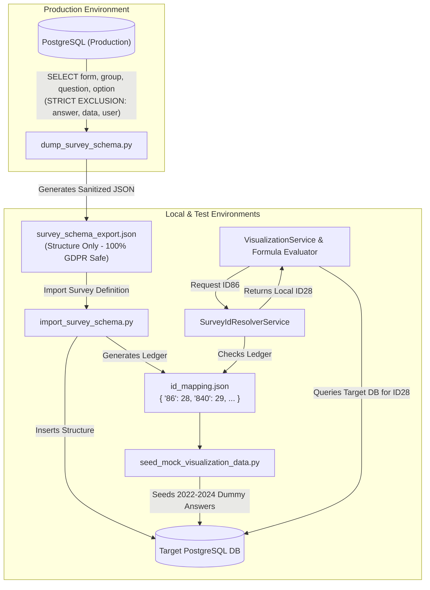

# Feature Specification: Survey Schema Portability & Multi-Environment ID Resolver

> **Document Type**: Feature Specification & Architecture Design
> **Feature Number**: `003`
> **Status**: `Ready for Implementation` | **Author**: Tech Lead (`bmad-architect`)
> **Scope**: Safe structure-only survey schema export/import, dynamic environment ID resolution, and synthetic visualization answer seeding.
> **Reference**: [docs/features/001_member_dashboard_spec.md](docs/features/001_member_dashboard_spec.md)

---

## 1. Executive Summary & Problem Statement

In the ISCO platform, **production survey responses contain sensitive, confidential commercial data** from member organizations that must strictly remain within the production boundary (GDPR and business confidentiality).

At the same time, auto-incrementing database primary keys (`form.id`, `question_group.id`, `question.id`) diverge across **Local**, **Test**, and **Production** environments:
- **Production**: Form `7`, Question `86` (*"Share of cocoa sourced directly"*)
- **Test**: Form `3`, Question `142`
- **Local**: Form `1`, Question `28`

Hardcoding production question IDs in features like the **Member Reporting Back Dashboard** (`visualization_mapping.json`) causes immediate failure on Local and Test environments.

### The Solution:
1. **Structure-Only Survey Schema Exporter**: Dumps the complete survey definition tree (`Form` ➔ `QuestionGroup` ➔ `Question` ➔ `Option` ➔ `Cascade` ➔ `SkipLogic`) into clean JSON, **strictly omitting all sensitive tables (`answer`, `data`, `organisation`, `user`)**.
2. **Idempotent Schema Importer with Mapping Ledger**: Imports the survey structure into target databases and records an **Environment ID Mapping Ledger** (`id_mapping.json`).
3. **Environment ID Resolver Service**: Automatically translates canonical production IDs (e.g. `ID86`) into the target environment's local database ID (e.g. `ID28`) at runtime before SQL query execution.
4. **Synthetic Visualization Data Seeder**: Generates realistic dummy answers matching the reference Excel template for local developers and QA testers.

---

## 2. Architecture & Data Flow



---

## 3. Touchpoint Files

| Operation | File Path | Purpose |
|---|---|---|
| `[CREATE]` | `/backend/scripts/dump_survey_schema.py` | Standalone CLI to export sanitized survey schema JSON from any environment. |
| `[CREATE]` | `/backend/scripts/import_survey_schema.py` | Idempotent CLI to import survey schema into target DB and generate `id_mapping.json`. |
| `[CREATE]` | `/backend/services/survey_id_resolver.py` | Runtime service that translates canonical/production IDs to local database IDs. |
| `[CREATE]` | `/backend/scripts/seed_mock_visualization_data.py` | Seeder creating synthetic 2022–2024 survey answers for local visualization testing. |
| `[CREATE]` | `/backend/tests/test_survey_sync_and_resolver.py` | Test suite verifying data sanitization, schema import, and ID translation logic. |

---

## 4. Technical Specifications

### 4.1 Full Survey Format Specification (`survey_schema_export.json`)
The export file contains the entire nested survey hierarchy covering all 8 structural layers (Form, QuestionGroup, Question, Option, Cascade, CascadeList, SkipLogic, and Access matrices) without any submission, organization, or user data:
```json
{
  "schema_version": "1.0",
  "exported_at": "2026-10-29T08:00:00Z",
  "source_environment": "production",
  "forms": [
    {
      "canonical_form_id": 7,
      "name": "Member Questionnaire",
      "description": "Annual sustainability reporting survey",
      "languages": ["en"],
      "version": 1.0,
      "enable_prefilled_value": false,
      "question_groups": [
        {
          "canonical_group_id": 90,
          "name": "Sourcing & Traceability",
          "description": "Direct and indirect sourcing volumes",
          "order": 1,
          "repeatable": false,
          "member_access": [1, 2, 3, 4],
          "isco_access": [1, 2, 3],
          "questions": [
            {
              "canonical_question_id": 86,
              "variable_name": "q_sourced_directly",
              "name": "Share of cocoa sourced directly",
              "type": "number",
              "mandatory": true,
              "core_mandatory": true,
              "deactivate": false,
              "datapoint_name": false,
              "order": 1,
              "rule": { "allow_decimal": true, "min": 0, "max": 100 },
              "options": [],
              "skip_logic": [],
              "cascade_id": null
            },
            {
              "canonical_question_id": 575,
              "variable_name": "q_clmrs_covered",
              "name": "Households covered by CLMRS",
              "type": "option",
              "mandatory": true,
              "options": [
                { "canonical_option_id": 101, "code": "YES", "name": "Yes", "order": 1 },
                { "canonical_option_id": 102, "code": "NO", "name": "No", "order": 2 }
              ],
              "skip_logic": [
                {
                  "dependent_to_canonical_question_id": 86,
                  "operator": "greater_than",
                  "value": "0",
                  "type": "number"
                }
              ]
            }
          ]
        }
      ],
      "cascades": [
        {
          "canonical_cascade_id": 5,
          "name": "Countries & Regions",
          "type": "cascade",
          "items": [
            { "canonical_item_id": 1, "code": "CI", "name": "Côte d'Ivoire", "parent_id": null, "level": 1 },
            { "canonical_item_id": 2, "code": "GH", "name": "Ghana", "parent_id": null, "level": 1 }
          ]
        }
      ]
    }
  ]
}
```

### 4.2 Two-Pass Idempotent Import Algorithm (`import_survey_schema.py`)
To preserve referential integrity when primary keys are re-sequenced in the target database:
1. **Pass 1 (Core Entities Creation)**:
   - Insert `Form` records.
   - Insert `QuestionGroup` records linked to `form_id`.
   - Insert `Cascade` and hierarchical `CascadeList` items, mapping old cascade IDs to new cascade IDs.
   - Insert `Question` and `Option` records.
   - Build in-memory ID ledger: `{ old_canonical_id: new_local_id }`.
2. **Pass 2 (Dependency Re-linking)**:
   - Re-link `Question.cascade` to the newly inserted `cascade.id`.
   - Re-link `SkipLogic.dependent_to` to the newly inserted `question.id`.
   - Remap `fn.fnString` in `Autofield` / Computed Validation questions to reference new local Question IDs.
   - Write verified `id_mapping.json` ledger.

### 4.2 Environment ID Mapping Ledger (`id_mapping.json`)
Generated automatically upon import in the target environment:
```json
{
  "target_environment": "local",
  "generated_at": "2026-10-29T08:05:00Z",
  "form_mapping": {
    "7": 1
  },
  "question_group_mapping": {
    "90": 12
  },
  "question_mapping": {
    "86": 28,
    "840": 29,
    "841": 30,
    "851": 31,
    "1216": 32,
    "842": 33,
    "847": 34,
    "575": 35,
    "577": 36,
    "873": 37,
    "579": 38,
    "874": 39
  }
}
```

### 4.3 Runtime ID Resolver Service (`survey_id_resolver.py`)
```python
import os
import json
from typing import Dict, Optional
from db.connection import session
from models.question import Question


class SurveyIdResolver:
    """
    Translates canonical/production Question IDs into local database IDs.
    In production: pass-through identity function.
    In local/test: resolves via id_mapping.json or dynamic variable_name matching.
    """
    _instance = None
    _mapping: Dict[int, int] = {}
    _loaded = False

    def __init__(self, mapping_path: str = "source/config/id_mapping.json"):
        self.mapping_path = mapping_path
        self.env = os.environ.get("CONFIG_SOURCE_PATH", "local").lower()

    def load_mapping(self):
        if self._loaded:
            return
        if self.env == "production":
            self._loaded = True
            return

        if os.path.exists(self.mapping_path):
            with open(self.mapping_path, "r") as f:
                data = json.load(f)
                self._mapping = {int(k): int(v) for k, v in data.get("question_mapping", {}).items()}
        self._loaded = True

    def resolve_question_id(self, canonical_id: int) -> int:
        self.load_mapping()
        # In production, canonical ID equals database ID
        if self.env == "production":
            return canonical_id
        # In local/test, resolve via ledger or fallback to canonical
        return self._mapping.get(canonical_id, canonical_id)

    def resolve_formula(self, formula: str) -> str:
        """
        Translates all ID tokens in an AST formula (e.g. 'ID840 + ID841')
        into target environment IDs ('ID29 + ID30').
        """
        self.load_mapping()
        if self.env == "production":
            return formula

        import re
        def replace_id(match):
            cid = int(match.group(1))
            lid = self.resolve_question_id(cid)
            return f"ID{lid}"

        return re.sub(r"ID(\d+)", replace_id, formula)
```

---

## 5. Granular Task Estimation & Sprint Plan (20.0 Hours / ~2.8 Days)

| Task ID | Task Description & Subtasks | Vibe Coding (Dev) | Automated Testing | QA & Review | Total Buffered | Independent QA Verification Gate |
| :--- | :--- | :---: | :---: | :---: | :---: | :--- |
| **SYNC-01** | **Structure-Only Survey Exporter CLI**<br>• Create `backend/scripts/dump_survey_schema.py`<br>• Query `Form`, `QuestionGroup`, `Question`, `Option`, `Cascade`, `SkipLogic`<br>• Enforce strict SQL exclusion of `answer`, `data`, `organisation`, `user`<br>• Dumps sanitized JSON schema with `canonical_id` attributes | 2.5h | 1.5h | 1.0h | **5.0h (~0.7d)** | **Independent Privacy Gate**:<br>QA runs script on database; inspects JSON file to verify it contains 0 rows of answers, organizations, or users. |
| **SYNC-02** | **Survey Schema Importer & Mapping Ledger**<br>• Create `backend/scripts/import_survey_schema.py`<br>• Reads `survey_schema_export.json` and inserts into target DB<br>• Idempotent upsert matching by name or `variable_name`<br>• Generates `id_mapping.json` pairing old $\rightarrow$ new IDs | 3.0h | 1.5h | 1.5h | **6.0h (~0.8d)** | **Independent Migration Gate**:<br>QA runs importer on empty DB; confirms survey is created and `id_mapping.json` records accurate old-to-new ID pairs. |
| **SYNC-03** | **Environment ID Resolver Service**<br>• Create `backend/services/survey_id_resolver.py`<br>• Implement `resolve_question_id` and `resolve_formula`<br>• Wire into AST formula evaluator in `visualization_service.py`<br>• Unit tests verifying environment switching and formula translation | 2.5h | 1.5h | 1.0h | **5.0h (~0.7d)** | **Independent Resolver Gate**:<br>Unit tests assert that in local env `ID86` translates to local ID, and in production it passes through unchanged. |
| **SYNC-04** | **Synthetic Visualization Answers Seeder**<br>• Create `backend/scripts/seed_mock_visualization_data.py`<br>• Uses resolved local Question IDs to seed dummy submissions for 2022–2024<br>• Replicates reference values from `5_Template DUMMY_Individual_reporting_back_ISCO_GISCO.xlsx` | 2.0h | 1.0h | 1.0h | **4.0h (~0.6d)** | **Independent Data Gate**:<br>QA triggers seeder; verifies `/api/visualization/individual-dashboard` returns full 3-year multi-line curves locally. |
| **TOTAL** | **Full Survey Portability & Multi-Environment Suite** | **10.0h** | **5.5h** | **4.5h** | **20.0h** | **~2.8 Working Days (0.6 Sprints)** |

---

## 6. User & Technical Acceptance Criteria (UAC & TAC)

### 👤 User Acceptance Criteria (UAC)
1. **UAC-01 (Data Privacy Guarantee)**: Exported survey files must never contain any member responses, organization identities, user accounts, or confidential survey answers.
2. **UAC-02 (Multi-Environment Consistency)**: The exact same dashboard code and configuration runs without modification across Local, Test, and Production environments.
3. **UAC-03 (Local Developer Autonomy)**: Developers and QA testers can work locally with realistic 3-year trend charts without needing access to production database dumps.

### ⚙️ Technical Acceptance Criteria (TAC)
1. **TAC-01 (Zero-Answer Whitelist Query)**:
   - Exporter queries explicitly whitelist `Form`, `QuestionGroup`, `Question`, and `Option` tables.
   - Code review verifies that `models.answer.Answer` and `models.data.Data` are never imported or queried.
2. **TAC-02 (Idempotent Import)**:
   - Re-running `import_survey_schema.py` does not create duplicate questions or violate unique constraints.
3. **TAC-03 (Resolver Performance)**:
   - `SurveyIdResolver` caches the mapping ledger in memory on first call ($O(1)$ dictionary lookup, latency $< 1\text{ms}$).
4. **TAC-04 (Formula Translation Parity)**:
   - Formula regex safely translates `ID840 + ID841` into `ID29 + ID30` in non-production environments while preserving original operators, parentheses, and functions.
5. **TAC-05 (Docker Execution Standard)**:
   - All scripts run via `./dc.sh exec backend python scripts/...`.
   - Test suite passes with $\ge 80\%$ test coverage: `./dc.sh exec backend pytest tests/test_survey_sync_and_resolver.py -v`.

