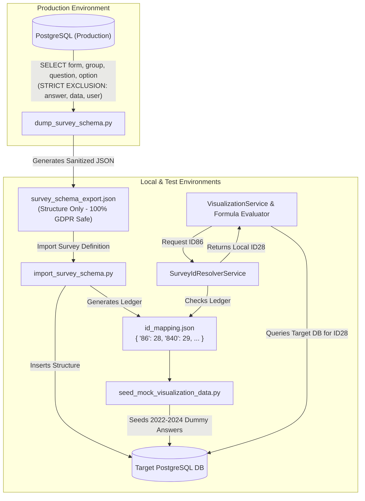

# Feature Specification: Survey Schema Portability & Multi-Environment ID Resolver

> **Document Type**: Feature Specification & Architecture Design
> **Feature Number**: `003`
> **Status**: `Ready for Implementation` | **Author**: Tech Lead (`bmad-architect`)
> **Scope**: Safe structure-only survey schema export/import, dynamic environment ID resolution, and synthetic visualization answer seeding.
> **Reference**: [docs/features/001_member_dashboard_spec.md](docs/features/001_member_dashboard_spec.md)

---

## 1. Executive Summary & Problem Statement

In the ISCO platform, **production survey responses contain sensitive, confidential commercial data** from member organizations that must strictly remain within the production boundary (GDPR and business confidentiality).

At the same time, auto-incrementing database primary keys (`form.id`, `question_group.id`, `question.id`) diverge across **Local**, **Test**, and **Production** environments:
- **Production**: Form `7`, Question `86` (*"Share of cocoa sourced directly"*)
- **Test**: Form `3`, Question `142`
- **Local**: Form `1`, Question `28`

Hardcoding production question IDs in features like the **Member Reporting Back Dashboard** (`visualization_mapping.json`) causes immediate failure on Local and Test environments.

### The Solution:
1. **Structure-Only Survey Schema Exporter**: Dumps the complete survey definition tree (`Form` ➔ `QuestionGroup` ➔ `Question` ➔ `Option` ➔ `Cascade` ➔ `SkipLogic`) into clean JSON, **strictly omitting all sensitive tables (`answer`, `data`, `organisation`, `user`)**.
2. **Idempotent Schema Importer with Mapping Ledger**: Imports the survey structure into target databases and records an **Environment ID Mapping Ledger** (`id_mapping.json`).
3. **Environment ID Resolver Service**: Automatically translates canonical production IDs (e.g. `ID86`) into the target environment's local database ID (e.g. `ID28`) at runtime before SQL query execution.
4. **Synthetic Visualization Data Seeder**: Generates realistic dummy answers matching the reference Excel template for local developers and QA testers.

---

## 2. Architecture & Data Flow



---

## 3. Touchpoint Files

| Operation | File Path | Purpose |
|---|---|---|
| `[CREATE]` | `/backend/scripts/dump_survey_schema.py` | Standalone CLI to export sanitized survey schema JSON from any environment. |
| `[CREATE]` | `/backend/scripts/import_survey_schema.py` | Idempotent CLI to import survey schema into target DB and generate `id_mapping.json`. |
| `[CREATE]` | `/backend/services/survey_id_resolver.py` | Runtime service that translates canonical/production IDs to local database IDs. |
| `[CREATE]` | `/backend/scripts/seed_mock_visualization_data.py` | Seeder creating synthetic 2022–2024 survey answers for local visualization testing. |
| `[CREATE]` | `/backend/tests/test_survey_sync_and_resolver.py` | Test suite verifying data sanitization, schema import, and ID translation logic. |

---

## 4. Technical Specifications

### 4.1 Full Survey Format Specification (`survey_schema_export.json`)
The export file contains the entire nested survey hierarchy covering all 8 structural layers (Form, QuestionGroup, Question, Option, Cascade, CascadeList, SkipLogic, and Access matrices) without any submission, organization, or user data:
```json
{
  "schema_version": "1.0",
  "exported_at": "2026-10-29T08:00:00Z",
  "source_environment": "production",
  "forms": [
    {
      "canonical_form_id": 7,
      "name": "Member Questionnaire",
      "description": "Annual sustainability reporting survey",
      "languages": ["en"],
      "version": 1.0,
      "enable_prefilled_value": false,
      "question_groups": [
        {
          "canonical_group_id": 90,
          "name": "Sourcing & Traceability",
          "description": "Direct and indirect sourcing volumes",
          "order": 1,
          "repeatable": false,
          "member_access": [1, 2, 3, 4],
          "isco_access": [1, 2, 3],
          "questions": [
            {
              "canonical_question_id": 86,
              "variable_name": "q_sourced_directly",
              "name": "Share of cocoa sourced directly",
              "type": "number",
              "mandatory": true,
              "core_mandatory": true,
              "deactivate": false,
              "datapoint_name": false,
              "order": 1,
              "rule": { "allow_decimal": true, "min": 0, "max": 100 },
              "options": [],
              "skip_logic": [],
              "cascade_id": null
            },
            {
              "canonical_question_id": 575,
              "variable_name": "q_clmrs_covered",
              "name": "Households covered by CLMRS",
              "type": "option",
              "mandatory": true,
              "options": [
                { "canonical_option_id": 101, "code": "YES", "name": "Yes", "order": 1 },
                { "canonical_option_id": 102, "code": "NO", "name": "No", "order": 2 }
              ],
              "skip_logic": [
                {
                  "dependent_to_canonical_question_id": 86,
                  "operator": "greater_than",
                  "value": "0",
                  "type": "number"
                }
              ]
            }
          ]
        }
      ],
      "cascades": [
        {
          "canonical_cascade_id": 5,
          "name": "Countries & Regions",
          "type": "cascade",
          "items": [
            { "canonical_item_id": 1, "code": "CI", "name": "Côte d'Ivoire", "parent_id": null, "level": 1 },
            { "canonical_item_id": 2, "code": "GH", "name": "Ghana", "parent_id": null, "level": 1 }
          ]
        }
      ]
    }
  ]
}
```

### 4.2 Two-Pass Idempotent Import Algorithm (`import_survey_schema.py`)
To preserve referential integrity when primary keys are re-sequenced in the target database:

#### Handling Existing Member Surveys in Target Database (Update vs. Create):
Because backend services rely on hardcoded static configuration lists like `MEMBER_SURVEY = [1, 7]` in `/backend/util/survey_config.py` (which determine submission locking, webform routing, and data export logic):
- **Default Strategy: In-Place Synchronized Update (`--mode update`)**:
  - If a Form with the target canonical ID already exists (e.g. `Form.id == 7`), or matches the active Member Questionnaire by name:
    - **Do NOT create a new Form with a different ID**, as that would break `MEMBER_SURVEY` static checks.
    - Instead, the importer updates the existing Form in-place: updates question groups, syncs questions/options, and preserves the Form's existing primary key.
- **Optional Strategy: Fresh Re-seed (`--mode clean` / `--target-form-id <id>`)**:
  - Allows targeting a specific existing `form.id` (e.g. `--target-form-id 1` or `7`), or cleanly truncating and re-inserting definition tables with exact canonical IDs in local development databases.

#### Two-Pass Execution Steps:
1. **Pass 1 (Core Entities Upsert)**:
   - Match or create target `Form` (preserving the `id in MEMBER_SURVEY` constraint).
   - Upsert `QuestionGroup` records linked to `form_id`.
   - Upsert `Cascade` and hierarchical `CascadeList` items, mapping old cascade IDs to new cascade IDs.
   - Upsert `Question` and `Option` records matching on `variable_name` or unique question `name`.
   - Build in-memory ID ledger: `{ old_canonical_id: new_local_id }`.
2. **Pass 2 (Dependency Re-linking)**:
   - Re-link `Question.cascade` to the newly inserted/updated `cascade.id`.
   - Re-link `SkipLogic.dependent_to` to the newly resolved `question.id`.
   - Remap `fn.fnString` in `Autofield` / Computed Validation questions to reference new local Question IDs.
   - Write verified `id_mapping.json` ledger.

### 4.2 Environment ID Mapping Ledger (`id_mapping.json`)
Generated automatically upon import in the target environment:
```json
{
  "target_environment": "local",
  "generated_at": "2026-10-29T08:05:00Z",
  "form_mapping": {
    "7": 1
  },
  "question_group_mapping": {
    "90": 12
  },
  "question_mapping": {
    "86": 28,
    "840": 29,
    "841": 30,
    "851": 31,
    "1216": 32,
    "842": 33,
    "847": 34,
    "575": 35,
    "577": 36,
    "873": 37,
    "579": 38,
    "874": 39
  }
}
```

### 4.3 Runtime ID Resolver Service (`survey_id_resolver.py`)
```python
import os
import json
from typing import Dict, Optional
from db.connection import session
from models.question import Question


class SurveyIdResolver:
    """
    Translates canonical/production Question IDs into local database IDs.
    In production: pass-through identity function.
    In local/test: resolves via id_mapping.json or dynamic variable_name matching.
    """
    _instance = None
    _mapping: Dict[int, int] = {}
    _loaded = False

    def __init__(self, mapping_path: str = "source/config/id_mapping.json"):
        self.mapping_path = mapping_path
        self.env = os.environ.get("CONFIG_SOURCE_PATH", "local").lower()

    def load_mapping(self):
        if self._loaded:
            return
        if self.env == "production":
            self._loaded = True
            return

        if os.path.exists(self.mapping_path):
            with open(self.mapping_path, "r") as f:
                data = json.load(f)
                self._mapping = {int(k): int(v) for k, v in data.get("question_mapping", {}).items()}
        self._loaded = True

    def resolve_question_id(self, canonical_id: int) -> int:
        self.load_mapping()
        # In production, canonical ID equals database ID
        if self.env == "production":
            return canonical_id
        # In local/test, resolve via ledger or fallback to canonical
        return self._mapping.get(canonical_id, canonical_id)

    def resolve_formula(self, formula: str) -> str:
        """
        Translates all ID tokens in an AST formula (e.g. 'ID840 + ID841')
        into target environment IDs ('ID29 + ID30').
        """
        self.load_mapping()
        if self.env == "production":
            return formula

        import re
        def replace_id(match):
            cid = int(match.group(1))
            lid = self.resolve_question_id(cid)
            return f"ID{lid}"

        return re.sub(r"ID(\d+)", replace_id, formula)
```

---

---

## 5. Unified Single-Task Breakdown & Estimation (1 Atomic Sprint Task)

To keep sprint management lean and focused, this capability is consolidated into **one cohesive task** (`TASK-SYNC`) delivering the end-to-end portability suite.

### 5.1 Single-Task Estimation Matrix

| Task ID | Task Description | Vibe Coding (Dev) | Automated Testing | QA & Review | Total Buffered | Independent QA Gate |
| :--- | :--- | :---: | :---: | :---: | :---: | :--- |
| **TASK-SYNC** | **Complete Survey Schema Portability & Multi-Environment ID Resolver Suite**<br>1. **CLI Exporter**: `dump_survey_schema.py` extracting all 8 structural survey layers (Form, Group, Question, Option, Cascade, CascadeList, SkipLogic, Access) without answers/users.<br>2. **Two-Pass CLI Importer**: `import_survey_schema.py` with idempotent upsert and referential dependency re-linking.<br>3. **Mapping Ledger & Resolver**: `survey_id_resolver.py` auto-translating canonical IDs to local database IDs.<br>4. **Synthetic Data Seeder**: `seed_mock_visualization_data.py` injecting 2022–2024 dummy answers.<br>5. **Automated Test Suite**: `test_survey_sync_and_resolver.py` testing export, import, round-trip parity, and resolver. | **6.0h** | **3.0h** | **2.5h** | **11.5h (~1.6 Working Days)** | **Full Round-Trip & Parity Gate**:<br>1. Dump survey from DB.<br>2. Inspect JSON: verify 0 sensitive answer/user rows.<br>3. Import JSON to clean test DB.<br>4. Run resolver & mock seeder.<br>5. Full regression passes with $\ge 80\%$ test coverage inside Docker. |

---

## 6. Detailed User & Technical Acceptance Criteria (UAC & TAC)

### 👤 User Acceptance Criteria (UAC)
- **UAC-SYNC.1 (Strict Privacy & Zero Data Leakage)**:
  - Exported survey files must strictly contain schema definitions only.
  - Zero rows of member answers, submitted questionnaires, user accounts, passwords, or organization identities can ever appear in the exported JSON.
- **UAC-SYNC.2 (Full 8-Layer Survey Coverage)**:
  - The export and import utility must handle the entire survey structure:
    1. Form metadata and versioning.
    2. Question groups (including repeatable sections and leading questions).
    3. Questions (all input, number, option, cascade, and autofield types).
    4. Options and multilingual translations.
    5. Hierarchical Cascades and CascadeLists (parent-child dropdown trees).
    6. Skip logic conditional branching rules.
    7. Autofield computed validation formulas.
    8. Member type and ISCO access control matrices.
- **UAC-SYNC.3 (Cross-Environment Parity)**:
  - The exact same codebase and indicator mapping (`visualization_mapping.json`) works seamlessly across Local, Test, and Production environments without manual ID re-mapping.
- **UAC-SYNC.4 (Local Developer Self-Sufficiency)**:
  - Running a single CLI command in Local Docker seeds realistic 2022–2024 test answers matching the partner Excel template, enabling immediate UI development without production database access.

### ⚙️ Technical Acceptance Criteria (TAC)
- **TAC-SYNC.1 (Zero-Answer SQL Whitelist)**:
  - `backend/scripts/dump_survey_schema.py` uses an explicit query whitelist for definition models only (`Form`, `QuestionGroup`, `Question`, `Option`, `Cascade`, `CascadeList`, `SkipLogic`).
  - Code review strictly verifies that `models.answer.Answer` and `models.data.Data` are never imported or queried.
- **TAC-SYNC.2 (Two-Pass Referential Integrity Algorithm)**:
  - `backend/scripts/import_survey_schema.py` executes in two deterministic passes within a single transactional session:
    - *Pass 1*: Inserts Forms, Groups, Cascades, Questions, and Options while building an in-memory mapping (`{ old_canonical_id: new_local_id }`).
    - *Pass 2*: Remaps `SkipLogic.dependent_to`, `Question.cascade_id`, and `fn.fnString` in Autofield formulas to point to the newly assigned local primary keys.
  - Idempotency: Re-running the script against an already imported schema updates existing records without duplicate rows or primary key constraint violations.
- **TAC-SYNC.3 (Environment Mapping Ledger)**:
  - Importer outputs `source/config/id_mapping.json` recording numeric mappings for forms, groups, and questions.
  - File format validation: Ledger contains only integer pairs (`{ "86": 28, ... }`), preventing SQL injection vectors.
- **TAC-SYNC.4 (Runtime ID Resolver Performance & Safety)**:
  - `backend/services/survey_id_resolver.py` provides `resolve_question_id(id)` and `resolve_formula(formula)`.
  - In Production (`CONFIG_SOURCE_PATH=production`), functions operate as zero-overhead identity pass-throughs.
  - In Local/Test, maps are cached in memory on first call ($O(1)$ dictionary lookup, latency $< 1\text{ms}$).
  - Regex translation cleanly replaces `ID86` $\rightarrow$ `ID28` while preserving operators, parentheses, and aggregation functions (`SUM`, `AVG`).
- **TAC-SYNC.5 (Synthetic Mock Seeder)**:
  - `backend/scripts/seed_mock_visualization_data.py` uses the resolved local IDs to generate test `Data` submissions and `Answer` values across 2022, 2023, and 2024 matching the reference Excel figures.
- **TAC-SYNC.6 (Docker Verification & Coverage Gate)**:
  - All scripts executable inside Docker via `./dc.sh exec backend python scripts/...`.
  - Pytest suite `tests/test_survey_sync_and_resolver.py` includes a full round-trip parity test (`dump` ➔ `import` ➔ `dump` ➔ compare structure) and achieves **$\ge 80\%$ test coverage**.
  - Flake8 linter passes with 0 violations: `./dc.sh exec backend flake8`.

