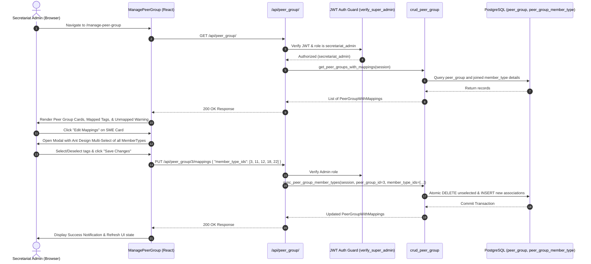

# Feature Specification: Admin Peer Group & Member Type Mapping Management UI

> **Document Type**: Feature Specification (TASK-01 Bonus Slice)
> **Status**: `Ready for Approval` | **Author**: Tech Lead (`bmad-architect`)
> **Related Issue**: [#687](https://github.com/akvo/isco/issues/687) | **Parent Epic**: [#685](https://github.com/akvo/isco/issues/685)
> **Parent Feature Spec**: [docs/features/001_member_dashboard_spec.md](docs/features/001_member_dashboard_spec.md)

---

## 1. Feature Overview & Requirements Discovery (5W1H)

### 5W1H Framework
- **Who**: Secretariat Admins and Super Admins (`secretariat_admin` / `verify_super_admin`). Strictly excludes member admins (`member_admin`) and regular member users (`member_user`).
- **What**: An administrative web interface and supporting REST endpoints to:
  1. View all harmonized peer groups (`Trader/Processor`, `Large Manufacturer`, `SME`, `Retail`) with their descriptions and count of member organizations.
  2. Inspect and dynamically update which platform `member_type` tags map to each `peer_group` using an interactive modal with multi-select tags.
  3. Inspect unmapped member types to safeguard against unclassified organizations.
- **Where**:
  - **Backend Route**: `/backend/routes/peer_group.py` (`GET /api/peer_group/`, `GET /api/peer_group/{id}`, `PUT /api/peer_group/{id}/mappings`).
  - **Backend CRUD**: `/backend/db/crud_peer_group.py`.
  - **Frontend Page**: `/frontend/src/pages/manage-peer-group/ManagePeerGroup.jsx`.
  - **Frontend Navigation**: Admin Hub (`/frontend/src/pages/admin/Admin.jsx`) & route `/manage-peer-group` in `/frontend/src/App.js`.
- **When**: Delivered as part of the TASK-01 slice before proceeding to TASK-02.
- **Why**: Allows platform administrators to manage peer group mappings whenever new member types are introduced or renamed, without requiring database migrations or manual SQL updates.
- **How**: The React UI calls `GET /api/peer_group/` to render peer group cards and active mappings. Admins click "Edit Mapping" to open an Ant Design Modal, adjust tags, and submit `PUT /api/peer_group/{id}/mappings`, updating `peer_group_member_type` inside a single database transaction.

---

## 2. Architecture & Data Flow



---

## 3. Touchpoint Files

| Operation | File Path | Purpose |
|---|---|---|
| `[MODIFY]` | `/backend/models/peer_group.py` | Add `PeerGroupWithMappingsDict` schema with nested member types and request payloads. |
| `[MODIFY]` | `/backend/db/crud_peer_group.py` | Add `get_peer_groups_with_mappings` and atomic `sync_peer_group_member_types`. |
| `[CREATE]` | `/backend/routes/peer_group.py` | REST API endpoints (`GET /peer_group/`, `GET /peer_group/{id}`, `PUT /peer_group/{id}/mappings`). |
| `[MODIFY]` | `/backend/main.py` | Register `peer_group_route` in FastAPI application router. |
| `[CREATE]` | `/frontend/src/pages/manage-peer-group/ManagePeerGroup.jsx` | Administrative UI page displaying peer group cards, member type tags, and edit modal. |
| `[CREATE]` | `/frontend/src/pages/manage-peer-group/EditPeerGroupMappingModal.jsx` | Modal dialog with searchable multi-select for mapping member types. |
| `[CREATE]` | `/frontend/src/pages/manage-peer-group/styles.scss` | Scoped styling adhering to ISCO design guidelines. |
| `[MODIFY]` | `/frontend/src/pages/admin/Admin.jsx` | Add "Manage Peer Groups" card to the administrative hub. |
| `[MODIFY]` | `/frontend/src/pages/index.js` | Export `ManagePeerGroup`. |
| `[MODIFY]` | `/frontend/src/App.js` | Register protected `/manage-peer-group` route. |
| `[CREATE]` | `/backend/tests/test_peer_group_routes.py` | Pytest integration suite for RBAC security, data contracts, and mapping synchronization. |

---

## 4. Backend Implementation Specification

### 4.1 Schema Definitions (`/backend/models/peer_group.py`)
```python
class MappedMemberTypeDict(TypedDict):
    id: int
    name: str


class PeerGroupWithMappingsDict(TypedDict):
    id: int
    name: str
    code: str
    description: Optional[str]
    created: str
    member_types: List[MappedMemberTypeDict]


class UpdatePeerGroupMappingsPayload(BaseModel):
    member_type_ids: List[int]
```

### 4.2 API Endpoint Contracts (`/backend/routes/peer_group.py`)

#### `GET /peer_group/`
- **Security**: Bearer Token (`verify_super_admin`). Only Secretariat Admins (`secretariat_admin`) allowed. Member Admins (`member_admin`) receive 403 Forbidden.
- **Status**: `200 OK`
- **Response**:
  ```json
  [
    {
      "id": 1,
      "code": "trader_processor",
      "name": "Trader/Processor",
      "description": "Traders and cocoa processors cohort",
      "created": "2026-10-29 17:05:00",
      "member_types": [
        { "id": 4, "name": "DISCO - Traders" },
        { "id": 20, "name": "FRISCO-Trader" },
        { "id": 23, "name": "Trader GISCO" },
        { "id": 24, "name": "Trader SWISSCO" }
      ]
    }
  ]
  ```

#### `GET /peer_group/{id}`
- **Security**: Bearer Token (`verify_super_admin`).
- **Status**: `200 OK` or `404 Not Found`.

#### `PUT /peer_group/{id}/mappings`
- **Security**: Bearer Token (`verify_super_admin`). Only Secretariat Admins allowed.
- **Payload**:
  ```json
  {
    "member_type_ids": [4, 20, 23, 24]
  }
  ```
- **Business Logic**:
  - Validates `peer_group_id` exists (raises 404 if missing).
  - Validates all `member_type_ids` exist in `member_type` table.
  - In a single transaction: deletes mappings removed from the list, inserts newly selected mappings, and preserves existing ones.
  - Returns the updated `PeerGroupWithMappingsDict`.

---

## 5. Frontend Implementation Specification

### 5.1 Route & Access Control
- Route: `/manage-peer-group`.
- RBAC: Accessible only by users with role `secretariat_admin` (platform super admin). Member Admins (`member_admin`) and regular users (`member_user`) are denied access (redirected to `/`). Unauthenticated users redirected to `/login`.

### 5.2 UI Components & Visual Layout
- **Page Header**:
  - Title: `Manage Peer Groups`
  - Subtitle: `Configure which member types map to each harmonized peer group cohort for benchmark reporting.`
  - Action button: `Back to Admin` linking to `/admin`.
- **Peer Group Cards Grid** (2-column responsive layout):
  - Each card represents one of the 4 harmonized peer groups (`Trader/Processor`, `Large Manufacturer`, `SME`, `Retail`).
  - Card Header: Peer Group Name and code badge.
  - Card Body:
    - Description text.
    - Tag list: Displays current mapped `member_type` tags with distinct color styling.
    - Tag count summary (e.g. `4 member types mapped`).
  - Card Footer: `Edit Mappings` button triggering the mapping modal.
- **Unmapped Member Types Alert**:
  - An Ant Design Info Alert at the bottom displaying any `member_type` tags currently not mapped to any peer group (e.g., `Government`, `Civil Society`, `Standard Setting Organisation`).
- **Edit Mapping Modal (`EditPeerGroupMappingModal.jsx`)**:
  - Searchable Ant Design `<Select mode="multiple">` populated with all platform `member_type` records.
  - Clean "Select All / Clear All" helpers.
  - Save and Cancel actions with loading state.

---

## 6. Verification & Quality Gates

All verification commands executed via `./dc.sh`:
- **Backend Tests**: `./dc.sh exec backend pytest tests/test_peer_group_routes.py -v`
- **Lint Check**: `./dc.sh exec backend flake8`
- **Coverage Gate**: Must maintain **$\ge 80\%$ test coverage** across `backend/routes/peer_group.py`, `backend/models/peer_group.py`, and `backend/db/crud_peer_group.py`.
- **Frontend Lint**: `./dc.sh exec frontend yarn lint`
- **Frontend Build**: `./dc.sh exec frontend yarn build`

---

## 7. Acceptance Criteria

- [ ] **UAC-01B.1**: Only Secretariat Admins (`secretariat_admin`) can access the Manage Peer Groups page from the Admin dashboard. Member Admins and regular members are denied access.
- [ ] **UAC-01B.2**: Admins can view all 4 peer groups and their currently associated member types.
- [ ] **UAC-01B.3**: Admins can update the member types mapped to any peer group via a multi-select modal and receive immediate feedback.
- [ ] **UAC-01B.4**: Unmapped member types are surfaced in an informational banner to prevent accidental omissions.
- [ ] **TAC-01B.1**: `backend/routes/peer_group.py` endpoints guarded by `verify_super_admin` (`secretariat_admin`) with strict HTTP 401/403 RBAC checks.
- [ ] **TAC-01B.2**: Mapping updates execute atomically inside a single database transaction.
- [ ] **TAC-01B.3**: Automated pytest test suite covering list, get, update mappings, invalid IDs, and unauthorized access.
- [ ] **TAC-01B.4**: Frontend code formatted with Prettier and passes `yarn lint` with 0 warnings/errors.

---

## 8. Calibrated Vibe Coding Estimation

| Task ID | Task Description & Subtasks | Vibe Coding (Dev) | Automated Testing | QA & Review | Total Est. |
| :--- | :--- | :---: | :---: | :---: | :---: |
| **TASK-01B.1** | **Backend REST Endpoints & Atomic CRUD**<br>• Add `PeerGroupWithMappingsDict` schema in `models/peer_group.py`<br>• Implement `get_peer_groups_with_mappings` and `sync_peer_group_member_types` in `db/crud_peer_group.py`<br>• Create `backend/routes/peer_group.py` with `verify_super_admin` guard (only `secretariat_admin`)<br>• Register router in `backend/main.py` | 1.5h | 1.0h | 0.5h | **3.0h** |
| **TASK-01B.2** | **Frontend Admin Page & Mapping Modal**<br>• Create `frontend/src/pages/manage-peer-group/ManagePeerGroup.jsx`<br>• Build `EditPeerGroupMappingModal.jsx` with Ant Design multi-select<br>• Build responsive grid layout & unmapped member types banner<br>• Style with scoped `styles.scss` adhering to ISCO design guidelines | 2.0h | 0.75h | 0.75h | **3.5h** |
| **TASK-01B.3** | **Navigation Wiring, Integration & Quality Gates**<br>• Add "Manage Peer Groups" card in `frontend/src/pages/admin/Admin.jsx`<br>• Register route in `frontend/src/App.js` and export in `pages/index.js`<br>• Pytest route tests (`test_peer_group_routes.py`) validating RBAC & transactions<br>• Enforce $\ge 80\%$ test coverage and Flake8/Yarn linting clean | 0.5h | 0.5h | 0.5h | **1.5h** |
| **TOTAL** | **TASK-01 Bonus Slice Delivery** | **4.0h** | **2.25h** | **1.75h** | **8.0h (~1.1d)** |

