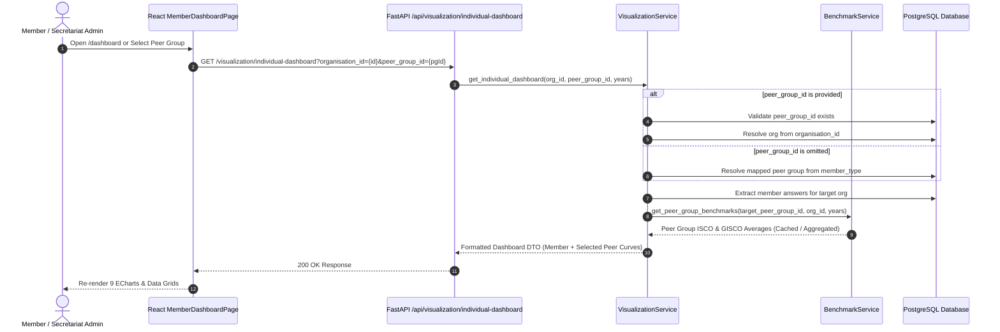

# [005] Peer Group Benchmark Filter Selector — Implementation Plan

> **Tracking Reference**:
> - **Issue**: Dynamic Peer Group Benchmark Comparison (Excel Parity)
> - **Specification File**: `/docs/features/005_peer_group_benchmark_filter_spec.md`
> - **Upstream LLD Reference**: `/docs/lld/member_dashboard_lld.md`
> - **Upstream HLD Reference**: `/docs/hld/member_dashboard_hld.md` (Section 1.3: Peer Group Benchmarking)

---

## Overview

In the original reference reporting template (*"Dashboard Member X"*), users could filter and dynamically recalculate report curves using an interactive **Peer Group Selector**. While the initial web dashboard implementation locked the benchmark curves to the member's mapped peer group (`member_type`), members and Secretariat Administrators require the flexibility to benchmark performance against other industry peer cohorts (e.g., comparing an SME against Large Manufacturers or Retailers) without altering the member's own submitted data.

This feature introduces a dynamic **Peer Group Selector `<Select>`** on the Member Dashboard. By default, it auto-selects the member's mapped peer group. When changed, the dashboard retains the member's annual curves while dynamically recalculating the **ISCO Average** and **GISCO Average** curves against the selected peer cohort.

---

## Requirements Discovery — 5W1H

- **Who**: Authenticated members (`member_user`, `member_admin`) seeking cross-cohort industry comparisons, and Secretariat Administrators (`secretariat_admin`) benchmarking members across any peer group.
- **What**: Interactive Peer Group dropdown selector (`Trader/Processor`, `Large Manufacturer`, `SME`, `Retail`) in the dashboard header.
- **Where**:
  - Backend Route: `/backend/routes/visualization.py`
  - Backend Service: `/backend/services/visualization_service.py`
  - Backend Tests: `/backend/tests/test_visualization.py`
  - Frontend Component: `/frontend/src/pages/member-dashboard/MemberDashboardPage.jsx`
  - Frontend Localization: `/frontend/src/static/ui-text.js`
  - Frontend Tests: `/frontend/src/pages/member-dashboard/MemberDashboardPage.test.jsx`
- **When**: On `/dashboard` page render, pre-populated with mapped default; on user selection change, triggers an instant refetch.
- **Why**: Delivers full parity with the Excel reference template and empowers members to understand where they stand relative to other market segments.
- **How**:
  1. Frontend fetches available peer groups via existing `GET /api/peer_group/`.
  2. `GET /api/visualization/individual-dashboard` accepts an optional `peer_group_id` query parameter.
  3. If `peer_group_id` is omitted, the service falls back to the organization's mapped peer group.
  4. If `peer_group_id` is provided, the service calculates benchmarks against that cohort while preserving the member's own organization time series.
  5. In-memory `TTLCache` caches benchmarks by `peer_group_id` for $<50\text{ms}$ repeated lookups.
  6. **Feature Flag Toggle**: Configured in `backend/source/config/visualization_mapping.json` via `"enable_peer_group_filter": true/false`. When disabled, the dropdown is cleanly hidden from the frontend and query param overrides are ignored.

---

## Architecture Overview



---

## 🎭 BMAD Party Mode Council Deliberation

### 1. 🏗️ Winston (System Architect)
* **Contract Compatibility**: `peer_group_id` is an optional query parameter (`peer_group_id: Optional[int] = Query(None)`). Existing clients and automated scripts that do not pass `peer_group_id` will experience zero breaking changes.
* **Validation Hierarchy**:
  1. If `peer_group_id` is provided but invalid (e.g. ID 9999), raise `404 Not Found: Peer group {id} not found`.
  2. If `peer_group_id` is provided for an unmapped organization (e.g. an admin inspecting `staff DISCO`), the dashboard **can compute benchmarks** against the requested peer group without failing with 422, allowing secretariat users to view hypothetical peer benchmarks.
  3. If `peer_group_id` is omitted, resolve from `member_type`. If unmapped, raise the current 422 error.
* **Payload Parity**: Return the active `peer_group` object in `response.organisation.peer_group` or `response.peer_group` so the frontend can synchronize its dropdown value.

### 2. 💻 Amelia (Senior Developer)
* **Backend Touchpoint**:
  In `VisualizationService.get_individual_dashboard`:
  ```python
  if peer_group_id:
      peer_group = session.query(PeerGroup).filter(PeerGroup.id == peer_group_id).first()
      if not peer_group:
          raise HTTPException(status_code=404, detail=f"Peer group {peer_group_id} not found")
      org = session.query(Organisation).filter(Organisation.id == organisation_id).first()
      if not org:
          raise HTTPException(status_code=404, detail=f"Organisation {organisation_id} not found")
  else:
      org, peer_group = self.resolve_organisation_peer_group(session, organisation_id)
  ```
* **Frontend Touchpoint**:
  Add a `selectedPeerGroupId` state hook in `MemberDashboardPage.jsx`:
  - Fetch available peer groups via `api.get('/peer_group/')`.
  - Render an Ant Design `<Select>` component beside the Secretariat switcher or under the page title.
  - Passing `peer_group_id: selectedPeerGroupId` in query parameters.

### 3. 🧪 Murat (Test Architect / QA)
* **Test Matrix**:
  1. **Default Resolution**: Omitted `peer_group_id` matches current behavior.
  2. **Valid Override**: Passing `peer_group_id=1` (Trader/Processor) calculates Trader/Processor benchmarks while retaining member data.
  3. **Non-Existent Peer Group**: Passing `peer_group_id=99999` returns 404.
  4. **Unmapped Organization with Explicit Peer Group**: Secretariat admin inspecting unmapped org can see benchmarks without 422 error.
  5. **Frontend State & UI Tests**: Verify changing peer group in `<Select>` dispatches API request with new `peer_group_id` and updates chart series.

### 4. 🛡️ Rachel (Security & Reviewer)
* **`[SEC]` Authorization**: `peer_group_id` is a public classification filter, not tenant-private data. Cross-cohort benchmark comparisons do not expose raw member answers.
* **`[DATA]` Anonymity Gate**: The $\ge 3$ reporting members threshold continues to apply strictly to whichever peer group cohort is evaluated. If fewer than 3 organizations submitted in that peer group, averages remain suppressed (`null`).
* **`[PERF]` Cache Efficiency**: In-memory `TTLCache` keys by `(peer_group_id, current_org_id, tuple(years))`. Switching between groups utilizes cached results instantly.

---

## 1. Backend Implementation

### 1.1 API Router
**File**: `/backend/routes/visualization.py`

```python
@visualization_route.get(
    "/visualization/individual-dashboard",
    response_model=IndividualDashboardResponse,
    summary="Get individual member dashboard with peer group benchmarks",
    name="visualization:individual_dashboard",
    tags=["Visualization"],
)
def get_individual_dashboard(
    req: Request,
    organisation_id: Optional[int] = Query(None, description="Target organisation id (secretariat_admin only)"),
    peer_group_id: Optional[int] = Query(None, description="Optional peer group ID override for benchmark comparisons"),
    years: Optional[List[int]] = Query(None, description="Optional list of monitoring round years"),
    session: Session = Depends(get_session),
    credentials: credentials = Depends(security),
    service: VisualizationService = Depends(get_visualization_service),
):
    ...
    return service.get_individual_dashboard(
        session=session,
        organisation_id=target_org_id,
        peer_group_id=peer_group_id,
        years=years,
    )
```

### 1.2 Service Layer
**File**: `/backend/services/visualization_service.py`

Update `get_individual_dashboard(session, organisation_id, peer_group_id=None, years=None)`:
- If `peer_group_id` is supplied: validate against `PeerGroup` table and use as cohort.
- If omitted: use `resolve_organisation_peer_group(...)`.

---

## 2. Frontend Implementation

### 2.1 State Management & Hooks
**File**: `/frontend/src/pages/member-dashboard/MemberDashboardPage.jsx`

- Query available peer groups: `api.get('/peer_group/')` on mount.
- State: `const [selectedPeerGroupId, setSelectedPeerGroupId] = useState(null)`.
- Synchronize: When `dashboardData` loads, if `selectedPeerGroupId` is null, set to `dashboardData.organisation.peer_group.id`.
- Request params:
  ```javascript
  const params = {};
  if (isAdmin && cleanOrgId) params.organisation_id = cleanOrgId;
  if (selectedPeerGroupId) params.peer_group_id = selectedPeerGroupId;
  ```

### 2.2 UI Header Component
Replace the static `<Tag>` with an interactive selector:
```text
+-------------------------------------------------------------------------------------------------+
| Dashboard Member X                                    [ Peer Group: Large Manufacturer (v) ]   |
| 2022 – 2026 Reporting Rounds                         [ Secretariat Switcher: Olam       (v) ]   |
+-------------------------------------------------------------------------------------------------+
```

---

## 3. Verification & Testing

### 3.1 Automated Tests
- **Backend**:
  `./dc.sh exec backend pytest tests/test_visualization.py`
  - Add `test_individual_dashboard_peer_group_override()`
  - Add `test_individual_dashboard_invalid_peer_group_404()`
- **Frontend**:
  `./dc.sh exec frontend yarn test src/pages/member-dashboard/ --watchAll=false`
  - Add test asserting peer group selector renders and triggers refetch on change.
- **Full Regression**:
  `./dc.sh exec backend ./test.sh`
  `./dc.sh exec frontend yarn lint`

---

## 4. Epic & Vibe Coding Estimation ⏱️

- **Confidence Level**: High (all underlying peer group models, seeders, and benchmark aggregation engines are already built and tested).
- **Dependencies**: None (builds on top of merged TASK-01 through TASK-06).

| Task ID | Component & Description | Vibe Coding (Dev) | Automated Testing | QA & Review | Total Est. Time | Priority |
| :--- | :--- | :---: | :---: | :---: | :---: | :--- |
| **TASK-05.1** | **Backend Route & Service Filter**<br>Add `peer_group_id` query param to `visualization.py`, validate against DB, and integrate override into `visualization_service.py` | 40m | 30m | 20m | **90m (1.5h)** | Must Have |
| **TASK-05.2** | **Backend Test Suite Expansion**<br>Add unit and integration tests covering default peer group, override peer group, invalid 404s, and unmapped org benchmark preview | 25m | 35m | 15m | **75m (1.25h)** | Must Have |
| **TASK-05.3** | **Frontend Peer Group Selector UI**<br>Fetch peer groups, add interactive `<Select>` in dashboard header, handle loading/sync state, and update bilingual localization | 45m | 30m | 20m | **95m (1.6h)** | Must Have |
| **TASK-05.4** | **Frontend RTL Component Tests**<br>Update `MemberDashboardPage.test.jsx` to verify peer group selection, API parameter dispatch, and curve updates | 25m | 35m | 15m | **75m (1.25h)** | Must Have |
| **TASK-05.5** | **Phase 4 Verification & Akvo Audit**<br>Run full backend (`./test.sh`), frontend (`yarn test`), linter (`flake8`, `yarn lint`), and build checks | 15m | 20m | 15m | **50m (0.8h)** | Must Have |
| **TOTAL** | **Full Feature Delivery** | **2.50h** | **2.50h** | **1.40h** | **6.40h (~0.8d)** | **High** |

---

## 🛑 HALT: Awaiting User Approval

This completes the **Phase 0: Planning & Estimation** specification and **BMAD Party Mode Deliberation**. No implementation code or file writes have been initiated.

Please review the specification and reply with **Proceed**, **Approved**, or `/2-implement` to begin implementation.

