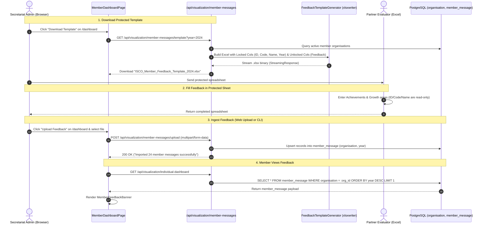

# Feature Specification: Member Dashboard Feedback Summary Message

> **Document Type**: Feature Specification (Phase 0: Planning & Estimation)  
> **Feature Number**: `006`  
> **Feature Name**: `member_dashboard_feedback_message`  
> **Status**: `Implemented & Verified (All Quality Gates Passing)`  
> **Author**: System Architect (`bmad-architect`) / Developer (`bmad-dev`)  
> **Scope**: Member Reporting Back Dashboard (`/dashboard`)  
> **Reference Docs**: [docs/lld/member_dashboard_lld.md](/docs/lld/member_dashboard_lld.md), [docs/features/001_member_dashboard_spec.md](/docs/features/001_member_dashboard_spec.md)

---

## Overview

During the pilot review of the Member Reporting Back Dashboard, stakeholders and member organizations requested qualitative guidance alongside quantitative indicator curves. In particular, each member organization's dashboard must surface an overall qualitative summary message reflecting their multi-year reporting performance (highlighting specific *Achievements* and *Growth Areas*, as demonstrated in the pilot samples).

To eliminate the risk of partner evaluators submitting corrupted member IDs, altered organization codes, or misattributed feedback, this specification incorporates an **in-platform Download Protected Template & Upload feature**:
1. **Protected Spreadsheet Template with Locked Identity Metadata**:
   Secretariat Admins can download an Excel template directly from the dashboard header (`GET /api/visualization/member-messages/template?year={year}`). In this file, all active member organizations are pre-populated. The member identity columns (`organisation_id` and `organisation_name`) are **digitally locked (read-only)** using Excel worksheet protection (`locked: True`) to eliminate typos and invalid IDs. The monitoring round `year` is pre-populated with default year but left **editable (unlocked)** so evaluators can specify or adjust the reporting round if needed. The feedback columns (`achievements`, `growth_areas`, `general_message`, `language`) are left **fully editable (unlocked)**.
2. **In-Platform & CLI Batch Ingestion**:
   Feedback can be ingested via the backend CLI script (`python -m scripts.import_member_messages`). The script defaults to `source/member_feedback.xlsx` (or `tmp/member_feedback.xlsx`) without needing a path parameter, or accepts an explicit `--file` path. The web upload function is kept in the backend API (`POST /api/visualization/member-messages/upload`) but hidden from the UI for now during manual seeding.
3. **Database & API Integration**:
   Messages are stored in PostgreSQL (`member_message`) with forward-compatible translation support (`translations` column). The active/latest monitoring year's message is delivered to `/dashboard` via `GET /api/visualization/individual-dashboard`.
4. **Bespoke Frontend Feedback Banner**:
   A prominent, accessible feedback banner (`MemberFeedbackBanner`) renders on `/dashboard` with distinct visual callouts for *Achievements* and *Growth areas*.

---

## Requirements Discovery (5W1H)

- **Who**: 
  - **Member Users & Admins (`member_user`, `member_admin`)**: View their organization's qualitative reporting summary.
  - **Secretariat Admins (`secretariat_admin`)**: Download pre-populated, protected feedback templates from the dashboard header and upload completed partner spreadsheets.
  - **Partners / Evaluators (e.g. Joy, Ulrike)**: Fill in feedback directly in the provided Excel template without the ability to accidentally modify organization codes, names, or IDs.
- **What**: 
  - Downloadable `.xlsx` template with cell-protection locking for member identity columns.
  - Web upload and CLI batch importer for partner feedback.
  - Member-level message storage in PostgreSQL with latest-year API resolution and dashboard feedback banner.
- **Where**:
  - **Database**: PostgreSQL table `member_message`.
  - **Backend**: `/backend/models/member_message.py`, `/backend/alembic/versions/xxxx_create_member_message_table.py`, `/backend/routes/visualization.py`, `/backend/services/visualization_service.py`, `/backend/util/feedback_template.py`, `/backend/scripts/import_member_messages.py`.
  - **Frontend**: `/frontend/src/pages/member-dashboard/MemberDashboardPage.jsx`, `/frontend/src/pages/member-dashboard/MemberFeedbackBanner.jsx`, `/frontend/src/pages/member-dashboard/styles.scss`.
- **When**: Delivered within the current sprint.
- **Why**: Prevent data entry errors, broken foreign keys, and organization typos by physically locking identifier cells in the exported template, giving partners a frictionless and foolproof feedback workflow.
- **How**: 
  - `xlsxwriter` applies `worksheet.protect()` with locked cell formatting on columns A–D, and unlocked formatting on columns E–H.
  - API streams the file with `responseType: blob`.
  - On upload, the parser validates records against the protected identifiers and upserts them into `member_message`.

---

## Architecture Overview & Data Flow



---

## 1. Protected Spreadsheet Template Specification

To make it impossible for evaluators to mistype organization names, delete IDs, or shift rows, the template is programmatically protected using open XML standards (`xlsxwriter`).

### 1.1 Column Schema & Protection Rules

| Col | Header | Excel Cell State | Data Type | Description |
| :---: | :--- | :---: | :---: | :--- |
| **A** | `organisation_id` | 🔒 **LOCKED** | Integer | Internal ISCO organization ID (e.g. `12`) |
| **B** | `organisation_name` | 🔒 **LOCKED** | String | Official member organization name (e.g. `Barry Callebaut`) |
| **C** | `year` | 🔓 **UNLOCKED** | Integer | Monitoring round year (e.g. `2024`) — Pre-populated, fully editable |
| **D** | `achievements` | 🔓 **UNLOCKED** | Text | Key accomplishments & positive indicators |
| **E** | `growth_areas` | 🔓 **UNLOCKED** | Text | Specific improvement areas & data provision needs |
| **F** | `general_message` | 🔓 **UNLOCKED** | Text | Optional custom free-form summary override |
| **G** | `language` | 🔓 **UNLOCKED** | String | Optional 2-letter ISO language code (default: `en`) |

### 1.2 Excel Worksheet Protection Implementation
In `/backend/util/feedback_template.py`:
```python
import xlsxwriter
from io import BytesIO

def generate_protected_feedback_template(organisations: list, year: int) -> BytesIO:
    output = BytesIO()
    workbook = xlsxwriter.Workbook(output, {'in_memory': True})
    worksheet = workbook.add_worksheet('Member Feedback')

    # Enable worksheet protection (allows editing unlocked cells only)
    worksheet.protect()

    # Formats
    header_format = workbook.add_format({
        'bold': True,
        'bg_color': '#e2e8f0',
        'border': 1,
        'font_color': '#1e293b'
    })
    locked_cell_format = workbook.add_format({
        'locked': True,
        'bg_color': '#f8fafc',
        'border': 1,
        'font_color': '#475569'
    })
    unlocked_cell_format = workbook.add_format({
        'locked': False,
        'bg_color': '#ffffff',
        'border': 1,
        'font_color': '#0f172a'
    })

    # Write Headers
    headers = [
        'organisation_id', 'organisation_name', 'year',
        'achievements', 'growth_areas', 'general_message', 'language'
    ]
    for col_idx, h in enumerate(headers):
        worksheet.write(0, col_idx, h, header_format)

    # Populate active members
    for row_idx, org in enumerate(organisations, start=1):
        worksheet.write(row_idx, 0, org.id, locked_cell_format)
        worksheet.write(row_idx, 1, org.name, locked_cell_format)
        # Year is pre-populated but UNLOCKED so evaluators can edit/backfill
        worksheet.write(row_idx, 2, year, unlocked_cell_format)
        worksheet.write_blank(row_idx, 3, None, unlocked_cell_format)
        worksheet.write_blank(row_idx, 4, None, unlocked_cell_format)
        worksheet.write_blank(row_idx, 5, None, unlocked_cell_format)
        worksheet.write(row_idx, 6, 'en', unlocked_cell_format)

    # Set column widths
    worksheet.set_column('A:A', 16)
    worksheet.set_column('B:B', 36)
    worksheet.set_column('C:C', 12)
    worksheet.set_column('D:F', 45)
    worksheet.set_column('G:G', 12)

    # Add Instructions tab
    _add_instructions_tab(workbook)

    workbook.close()
    output.seek(0)
    return output
```

When opened in Excel:
- Columns A–D cannot be modified (attempting to type displays Excel's *"The cell is on a protected sheet"* warning).
- Columns E–H are completely open for typing or pasting feedback.

---

## 2. Backend Implementation

### 2.1 Database Model (`/backend/models/member_message.py`)
```python
from datetime import datetime
from typing import Optional, List
from typing_extensions import TypedDict
from sqlalchemy import (
    Column,
    Integer,
    DateTime,
    Text,
    ForeignKey,
    UniqueConstraint,
)
import sqlalchemy.dialects.postgresql as pg
from db.connection import Base


class MemberMessageDict(TypedDict):
    id: int
    organisation: int
    year: int
    message: str
    translations: Optional[List[dict]]
    created: datetime
    updated: Optional[datetime]


class MemberMessage(Base):
    __tablename__ = "member_message"

    id = Column(Integer, primary_key=True, index=True, nullable=False)
    organisation = Column(
        Integer,
        ForeignKey("organisation.id", ondelete="CASCADE"),
        nullable=False,
        index=True,
    )
    year = Column(Integer, nullable=False, index=True)
    message = Column(Text, nullable=False)
    translations = Column(pg.ARRAY(pg.JSONB), nullable=True)
    created = Column(DateTime, default=datetime.utcnow, nullable=False)
    updated = Column(
        DateTime,
        default=datetime.utcnow,
        onupdate=datetime.utcnow,
        nullable=True,
    )

    __table_args__ = (
        UniqueConstraint(
            "organisation",
            "year",
            name="uq_member_message_org_year",
        ),
    )

    def __init__(
        self,
        organisation: int,
        year: int,
        message: str,
        translations: Optional[List[dict]] = None,
    ):
        self.organisation = organisation
        self.year = year
        self.message = message
        self.translations = translations
```

### 2.2 Alembic Migration (`/backend/alembic/versions/xxxx_create_member_message_table.py`)
- Creates table `member_message`.
- Foreign key to `organisation.id` (`ondelete="CASCADE"`).
- Unique constraint `uq_member_message_org_year` on `(organisation, year)`.
- Indices on `organisation` and `year`.

### 2.3 API Endpoints (`/backend/routes/visualization.py`)

#### `GET /api/visualization/member-messages/template`
- **Role**: `secretariat_admin` only.
- Query Parameter: `year: Optional[int]` (defaults to active monitoring round / current year).
- Returns: `StreamingResponse` streaming `application/vnd.openxmlformats-officedocument.spreadsheetml.sheet` with header `Content-Disposition: attachment; filename=ISCO_Member_Feedback_Template_{year}.xlsx`.

#### `POST /api/visualization/member-messages/upload`
- **Role**: `secretariat_admin` only.
- Payload: `file: UploadFile = File(...)`, `dry_run: bool = Form(False)`.
- Reads Excel or CSV file in-memory using `pandas` / `openpyxl`.
- Validates rows and synthesizes Markdown from `achievements` and `growth_areas`.
- Upserts rows into `member_message`.
- Returns:
  ```json
  {
    "status": "success",
    "total_rows": 24,
    "imported": 24,
    "errors": []
  }
  ```

#### `GET /api/visualization/individual-dashboard`
- Delivers `member_message: Optional[MemberMessageDTO]` with the most recent year's record for `target_org_id`.

---

## 3. Frontend Implementation

### 3.1 Feedback Banner Component (`/frontend/src/pages/member-dashboard/MemberFeedbackBanner.jsx`)
- Renders an informative card beneath the dashboard header with anti-slop editorial design.
- Displays the reporting round year tag in the header (e.g. `Annual Reporting Feedback (2024)`).
- Formats structured feedback:
  - Highlights *Achievements* with a subtle forest-green badge/accent border (`#2e7d32`).
  - Highlights *Growth area* with a subtle amber/terracotta badge/accent border (`#b45309`).
- Returns `null` if `dashboardData?.member_message` is absent or empty, except when user is a Secretariat Admin (`secretariat_admin`), where it renders a clean header showing "No feedback recorded..." alongside the template download action.
- Integrates the **"Download Feedback Template"** action into the banner header for Secretariat Admins, keeping feedback actions unified and removing awkward toolbar clutter.
- Note: Web upload UI is hidden for now as feedback is seeded manually via CLI.

### 3.2 Wireframe with Banner Header Download Action

```text
+-------------------------------------------------------------------------------------------------+
| [Dashboard Eyebrow] ISCO Sustainability Reporting Back                                          |
| Dashboard – Member Organization Name                                                            |
| Peer Group: Large Manufacturer | Range: 2022 - 2024                                             |
|                                                                                                 |
| [Select Member Dropdown ▼]                                                                      |
+-------------------------------------------------------------------------------------------------+
|                                                                                                 |
|  +-- [Member Reporting Feedback Card] -------------------------------------------------------+  |
|  | Annual Reporting Feedback (2024)                    [📥 Download Feedback Template (.xlsx)] |  |
|  |                                                                                           |  |
|  | Achievements: The member's achievements are largely in line with its peer group.          |  |
|  |               Particularly positive is improved reporting on child labour indicators.      |  |
|  | Growth area:  There is overall a need for increased provision of data and improvement     |  |
|  |               with respect to traceability and deforestation free cocoa.                  |  |
|  +-------------------------------------------------------------------------------------------+  |
|                                                                                                 |
|  === Challenges & Charts follow below ===                                                        |
+-------------------------------------------------------------------------------------------------+
```

---

## 4. User & Technical Acceptance Criteria (UAC & TAC)

### TASK-1.1: Database Model & Alembic Migration (`member_message`)
- **UAC (User Acceptance Criteria)**:
  - **UAC-06.1.1**: The system stores qualitative messages linked to specific member organizations and monitoring years.
  - **UAC-06.1.2**: Multiple monitoring years can be stored per member organization (e.g. 2023, 2024) to track progress over time.
  - **UAC-06.1.3**: Re-importing or updating a message for the same organization and year updates the existing message cleanly without creating duplicate records.
- **TAC (Technical Acceptance Criteria)**:
  - **TAC-06.1.1**: SQLAlchemy model `MemberMessage` in `/backend/models/member_message.py` with foreign key `organisation -> organisation.id` (`ondelete="CASCADE"`).
  - **TAC-06.1.2**: Unique constraint `uq_member_message_org_year` on `(organisation, year)`.
  - **TAC-06.1.3**: `translations` column defined as `pg.ARRAY(pg.JSONB)` adhering to ISCO platform multilingual conventions.
  - **TAC-06.1.4**: Idempotent Alembic migration creating the table with indices on `organisation` and `year`, and clean reversible downgrade (`alembic downgrade -1`).
  - **TAC-06.1.5**: Automated PyTest unit tests verifying database CRUD operations, cascade deletion, and uniqueness constraint enforcement.

### TASK-1.2: Service Layer & Individual Dashboard API Integration
- **UAC (User Acceptance Criteria)**:
  - **UAC-06.2.1**: A logged-in member viewing `/dashboard` sees their qualitative feedback for the active/latest monitoring round.
  - **UAC-06.2.2**: If a member organization has no feedback record for that round, the dashboard renders normally without error messages or broken layout gaps.
  - **UAC-06.2.3**: Secretariat Admins switching organizations immediately see the respective member's qualitative feedback updated in sync with their quantitative curves.
  - **UAC-06.2.4**: Regular members cannot access or view another member organization's confidential feedback.
- **TAC (Technical Acceptance Criteria)**:
  - **TAC-06.2.1**: `VisualizationService.get_individual_dashboard` queries `MemberMessage` filtered by `target_org_id`, sorted by `year.desc()`, and limited to 1 record.
  - **TAC-06.2.2**: If a single `year` query parameter is passed (e.g. `?years=2023`), the query filters by `year == 2023`.
  - **TAC-06.2.3**: `IndividualDashboardResponse` schema in `/backend/routes/visualization.py` includes `member_message: Optional[MemberMessageDTO] = None`.
  - **TAC-06.2.4**: Enforces strict multi-tenant RBAC: non-secretariat users attempting to view another organization's dashboard/feedback receive `403 Forbidden`.
  - **TAC-06.2.5**: PyTest integration tests validating response structure with message present, message absent (`null`), and RBAC boundary enforcement.

### TASK-1.3: Protected Excel Template Generator & Batch Ingestion Service
- **UAC (User Acceptance Criteria)**:
  - **UAC-06.3.1**: Secretariat Admins can click a "Download Feedback Template" button on `/dashboard` to get an Excel `.xlsx` file pre-populated with all active member organizations.
  - **UAC-06.3.2**: In the downloaded Excel file, Columns A–B (`organisation_id`, `organisation_name`) are locked and protected against editing, preventing accidental typos and broken mappings.
  - **UAC-06.3.3**: Column C (`year`) is pre-populated with the target monitoring round (e.g. `2024`) but remains fully editable so evaluators can backfill or adjust years.
  - **UAC-06.3.4**: Columns D–G (`achievements`, `growth_areas`, `general_message`, `language`) are unlocked and fully editable.
  - **UAC-06.3.5**: Feedback can be ingested via the CLI importer script (`python -m scripts.import_member_messages`) with automatic default location resolution (`source/member_feedback.xlsx` / `tmp/member_feedback.xlsx`).
  - **UAC-06.3.6**: CLI script supports `--dry-run` to validate file contents and detect unmapped organizations before persisting.
- **TAC (Technical Acceptance Criteria)**:
  - **TAC-06.3.1**: `generate_protected_feedback_template` in `/backend/util/feedback_template.py` uses `xlsxwriter` with `worksheet.protect()` and selective cell formatting (`locked: True` on A-B, `locked: False` on C-G).
  - **TAC-06.3.2**: `GET /api/visualization/member-messages/template` streams binary `.xlsx` with `StreamingResponse` and `Content-Disposition` attachment headers; restricted to `secretariat_admin`.
  - **TAC-06.3.3**: `POST /api/visualization/member-messages/upload` accepts `multipart/form-data`, validates columns, resolves organizations, formats `achievements` + `growth_areas` into standard Markdown, and upserts into `member_message`.
  - **TAC-06.3.4**: `/backend/scripts/import_member_messages.py` CLI script mirrors the API upload parser with identical validation, default paths, and `--dry-run` flags.
  - **TAC-06.3.5**: PyTest tests verifying template protection attributes, valid file uploads, invalid file structures, and dry-run execution.

### TASK-1.4: Frontend MemberFeedbackBanner & Secretariat Action UI
- **UAC (User Acceptance Criteria)**:
  - **UAC-06.4.1**: Feedback banner renders prominently beneath the dashboard header, showing the message year in the header (e.g. `Annual Reporting Feedback (2024)`).
  - **UAC-06.4.2**: Key accomplishments are highlighted under an *Achievements* callout (forest-green rubric accent `#2e7d32`), and improvement areas are highlighted under a *Growth area* callout (amber rubric accent `#b45309`).
  - **UAC-06.4.3**: When `member_message` is null or empty, the banner renders the default feedback message in the content body with language translation support, keeping the standard header intact.
  - **UAC-06.4.4**: Only Secretariat Admins (`secretariat_admin`) see the "Download Feedback Template" action in the feedback banner header.
  - **UAC-06.4.5**: Clicking "Download Feedback Template" triggers an in-browser file download with active loading feedback.
- **TAC (Technical Acceptance Criteria)**:
  - **TAC-06.4.1**: `MemberFeedbackBanner.jsx` component implemented in `/frontend/src/pages/member-dashboard/` with Markdown/structured section parsing and integrated download template action.
  - **TAC-06.4.2**: Integrated into `MemberDashboardPage.jsx` with conditional rendering `dashboardData?.member_message` and fallback header for Secretariat Admins.
  - **TAC-06.4.3**: Download action wired using `api.get('/visualization/member-messages/template', { responseType: 'blob' })` with dynamic year parameter.
  - **TAC-06.4.4**: SCSS styling in `styles.scss` adhering to ISCO design tokens (colors `#2e7d32` for achievements, `#b45309` for growth areas, `#673016` cacao accent border).
  - **TAC-06.4.5**: Jest tests in `MemberDashboardPage.test.jsx` and `MemberFeedbackBanner.test.jsx` verifying banner rendering, null collapse, admin button visibility for `secretariat_admin`, and hidden state for `member_user`.

---

## 5. Verification & Testing

### 5.1 Automated Tests
- **Backend Tests** (`./dc.sh exec backend pytest tests/test_visualization.py`):
  - `test_member_message_model_and_unique_constraint`: Verify model persistence and unique `(organisation, year)` constraint.
  - `test_generate_protected_feedback_template_structure_and_locks`: Verify `GET /api/visualization/member-messages/template` generates a protected `.xlsx` with locked columns A–B (ID, Name) and unlocked columns C–G (Year, Feedback, Language).
  - `test_upload_feedback_spreadsheet_endpoint`: Verify `POST /api/visualization/member-messages/upload` validates headers, synthesizes achievements & growth areas, and upserts rows.
  - `test_upload_feedback_spreadsheet_dry_run`: Verify dry-run mode returns preview statistics without altering database state.
  - `test_get_individual_dashboard_with_member_message`: Verify response includes `member_message` when available.
  - `test_get_individual_dashboard_without_member_message`: Verify response returns `member_message: None` gracefully.
- **Frontend Tests** (`./dc.sh exec frontend yarn test src/pages/member-dashboard`):
  - `MemberDashboardPage.test.jsx`:
    - Secretariat Admin sees "Download Feedback Template" action in feedback banner.
    - Regular member user does NOT see admin download actions.
    - Triggering template download calls API with `responseType: blob`.
    - Renders `MemberFeedbackBanner` when `member_message` is returned.
  - `MemberFeedbackBanner.test.jsx`:
    - Renders achievements and growth area boxes with appropriate styling.
    - Renders raw general message fallback.
    - Handles Secretariat Admin header download action.

### 5.2 Manual Verification Steps
1. Log in as Secretariat Admin.
2. In `/dashboard`, click **"Download Feedback Template"** in the Feedback Banner header.
3. Open `ISCO_Member_Feedback_Template_2024.xlsx` in Excel:
   - Try to change an organization name or ID: verify Excel displays a protection warning and blocks editing.
   - Enter text into the *Achievements* and *Growth areas* columns: verify editing works smoothly.
4. Save the file to `backend/source/member_feedback.xlsx` (or run `./dc.sh exec backend python -m scripts.import_member_messages`).
5. Verify terminal output (`"Successfully imported member messages"`).
6. Refresh `/dashboard`: confirm the feedback banner appears with the newly imported content.

---

## 6. Epic & Vibe Coding Estimation ⏱️

- **Confidence Level**: High
- **Dependencies**: None

| Task ID | Component & Description | Vibe Coding (Dev) | Automated Testing | QA & Review | Total Est. Time | Priority |
| :--- | :--- | :---: | :---: | :---: | :---: | :--- |
| **TASK-1.1** | **Backend**: Create `MemberMessage` model, Alembic migration, and unique constraint | 25m | 20m | 15m | **60m (1.0h)** | P1 |
| **TASK-1.2** | **Backend**: Ingest & Service layer — resolve latest member message in `VisualizationService`, add `MemberMessageDTO` | 30m | 25m | 15m | **70m (1.2h)** | P1 |
| **TASK-1.3** | **Backend (Template & Ingestion)**: Protected Excel generator service (`feedback_template.py`), `GET /template` download endpoint, and `POST /upload` endpoint + CLI script | 45m | 30m | 20m | **95m (1.6h)** | P1 |
| **TASK-1.4** | **Frontend**: Implement `MemberFeedbackBanner`, add "Download Template" & "Upload Feedback" actions in Secretariat toolbar on `MemberDashboardPage` | 40m | 30m | 20m | **90m (1.5h)** | P1 |
| **TOTAL** | **Feature 006 Delivery** | **140m** | **105m** | **70m** | **315m (~5.25h)** | |

---

## 7. Handoff & Next Steps

This concludes **Phase 0: Planning & Estimation** for Feature 006.
- Spec file: [`docs/features/006_member_dashboard_feedback_message_spec.md`](/docs/features/006_member_dashboard_feedback_message_spec.md)
- Companion Spec (Chart Info Tooltips): [`docs/features/007_member_dashboard_chart_info_tooltips_spec.md`](/docs/features/007_member_dashboard_chart_info_tooltips_spec.md)
- **Handoff**: Awaiting approval to proceed to implementation via `/2-implement`.
