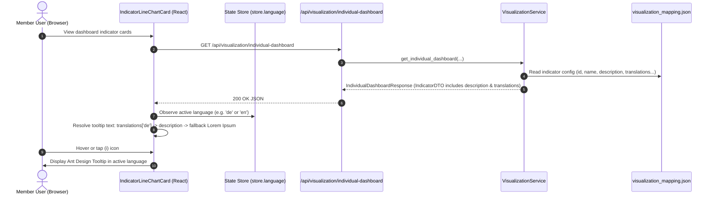

# Feature Specification: Member Dashboard Chart Info Tooltips

> **Document Type**: Feature Specification (Phase 0: Planning & Estimation)  
> **Feature Number**: `007`  
> **Feature Name**: `member_dashboard_chart_info_tooltips`  
> **Status**: `Ready for Review & Approval`  
> **Author**: System Architect (`bmad-architect`) / Developer (`bmad-dev`)  
> **Scope**: Member Reporting Back Dashboard (`/dashboard`)  
> **Reference Docs**: [docs/lld/member_dashboard_lld.md](/docs/lld/member_dashboard_lld.md), [docs/features/001_member_dashboard_spec.md](/docs/features/001_member_dashboard_spec.md)

---

## Overview

Based on stakeholder feedback from the recent pilot review, every sustainability indicator chart rendered on the Member Reporting Back Dashboard must feature an informative `(i)` info icon in its card header. 

When hovering or clicking this info icon, users are presented with a tooltip/popover explaining the definition, scope, and calculation methodology of that indicator. In accordance with the voice note instruction, a placeholder "Lorem Ipsum" description will be initialized for all 9 indicators via `visualization_mapping.json`.

To preempt future localization requirements (just as with member feedback messages), the configuration, backend API, and frontend components will support **preemptive multi-language translations** (`translations` list). If a user switches the dashboard language (e.g. to German or French), the tooltip dynamically renders the translated explanation, with a graceful fallback to the default English description or placeholder text.

---

## Requirements Discovery (5W1H)

- **Who**: 
  - **Member Users & Admins (`member_user`, `member_admin`)**: Hover/tap the info icon on any chart card to understand the underlying methodology and data context in their selected language.
  - **Secretariat Admins (`secretariat_admin`)**: Maintain and update indicator explanation texts and translations centrally via `visualization_mapping.json`.
- **What**: An accessible `(i)` info icon on every indicator chart card displaying an indicator description tooltip with multi-language translation support.
- **Where**:
  - **Configuration**: `/backend/source/config/visualization_mapping.json`.
  - **Backend**: `/backend/routes/visualization.py` (`IndicatorDTO`), `/backend/services/visualization_service.py`.
  - **Frontend**: `/frontend/src/pages/member-dashboard/IndicatorLineChartCard.jsx`, `/frontend/src/pages/member-dashboard/styles.scss`.
- **When**: Delivered within the current sprint.
- **Why**: Many sustainability indicators involve complex calculations and scope definitions (e.g. West Africa child labour identification, polygon deforestation tracking). Users need in-situ definitions in their preferred language without navigating away from the dashboard.
- **How**:
  - Each indicator in `visualization_mapping.json` is configured with `description` and optional `translations: [{"language": "de", "description": "..."}]`.
  - The backend includes `description` and `translations` in `IndicatorDTO`.
  - The frontend dynamically resolves the description matching `store.language.active`, with fallback to English/Lorem Ipsum.

---

## Architecture Overview & Data Flow



---

## 1. Backend Implementation

### 1.1 Configuration (`/backend/source/config/visualization_mapping.json`)
Add a `description` field and preemptive `translations` list to each indicator:

```json
{
  "id": "sourced_directly",
  "name": "Share of cocoa sourced directly",
  "country": "Global",
  "description": "Lorem ipsum dolor sit amet, consectetur adipiscing elit. This indicator measures the proportion of cocoa volumes purchased directly from first-tier farmer organizations or certified supply chains.",
  "translations": [
    {
      "language": "de",
      "description": "Lorem ipsum dolor sit amet auf Deutsch. Dieser Indikator misst den Anteil des Kakaos, der direkt von bäuerlichen Organisationen bezogen wird."
    },
    {
      "language": "fr",
      "description": "Lorem ipsum dolor sit amet en français. Cet indicateur mesure la part du cacao achetée directement auprès des coopératives de producteurs."
    }
  ],
  "form_id": 7,
  "type": "percentage",
  "chart_type": "line",
  "higher_is_better": true
}
```

### 1.2 Schema Update (`/backend/routes/visualization.py`)
Update `IndicatorDTO` to include both `description` and `translations`:

```python
class IndicatorDTO(BaseModel):
    id: str
    name: str
    country: str
    unit: str
    chart_type: str
    higher_is_better: bool
    description: Optional[str] = None
    translations: Optional[List[dict]] = None
    series: List[IndicatorSeriesPoint]

    class Config:
        orm_mode = True
```

### 1.3 Service Mapping (`/backend/services/visualization_service.py`)
In `VisualizationService._build_indicator_dto`:
```python
DEFAULT_LOREM_IPSUM = (
    "Lorem ipsum dolor sit amet, consectetur adipiscing elit. "
    "Sed do eiusmod tempor incididunt ut labore et dolore magna aliqua."
)

indicator_dto = {
    "id": ind_cfg.get("id"),
    "name": ind_cfg.get("name"),
    "country": ind_cfg.get("country", ""),
    "unit": ind_cfg.get("unit", "percentage"),
    "chart_type": ind_cfg.get("chart_type", "line"),
    "higher_is_better": ind_cfg.get("higher_is_better", True),
    "description": ind_cfg.get("description") or DEFAULT_LOREM_IPSUM,
    "translations": ind_cfg.get("translations", []),
    "series": series_points,
}
```

---

## 2. Frontend Implementation

### 2.1 Reactive Language Resolution (`/frontend/src/pages/member-dashboard/IndicatorLineChartCard.jsx`)
In `IndicatorLineChartCard.jsx`:
- Subscribe to `store.useState(s => s.language)`.
- Dynamically resolve the tooltip text based on active language:

```jsx
const DEFAULT_LOREM_IPSUM =
  "Lorem ipsum dolor sit amet, consectetur adipiscing elit. " +
  "Sed do eiusmod tempor incididunt ut labore et dolore magna aliqua.";

const indicatorDescription = useMemo(() => {
  if (!indicator) return "";

  // 1. Check if active language translation exists in indicator.translations
  if (Array.isArray(indicator.translations)) {
    const matched = indicator.translations.find(
      (t) => t.language === activeLang && t.description
    );
    if (matched?.description) {
      return matched.description;
    }
  }

  // 2. Check static uiText localization if defined
  if (text.indicatorDescriptions?.[indicator.id]) {
    return text.indicatorDescriptions[indicator.id];
  }

  // 3. Fallback to default indicator description or global placeholder
  return indicator.description || DEFAULT_LOREM_IPSUM;
}, [indicator, activeLang, text]);
```

### 2.2 Component UI & Header Actions
Render the info button in the card header (inside `card-extra-actions`):

```jsx
<div className="card-extra-actions">
  {unitName && <Tag className="unit-tag">{unitName}</Tag>}
  <Tooltip
    title={indicatorDescription}
    placement="topRight"
    overlayClassName="chart-info-tooltip"
  >
    <button
      type="button"
      className="chart-info-btn"
      aria-label={`About ${indicatorName}`}
    >
      <InfoCircleOutlined className="chart-info-icon" />
    </button>
  </Tooltip>
</div>
```

### 2.3 Styling (`/frontend/src/pages/member-dashboard/styles.scss`)
- Clean, accessible button reset (`background: none; border: none; padding: 0; cursor: pointer;`).
- Icon colors: subtle slate `#94a3b8`, transitions to primary `#0284c7` on hover/focus.
- Accessible touch target: `min-width: 32px; min-height: 32px; display: inline-flex; align-items: center; justify-content: center;`.
- Focus-visible ring for keyboard accessibility (`outline: 2px solid #0284c7; outline-offset: 2px`).

### 2.4 Wireframe

```text
+-- [Card: Share of cocoa sourced directly] -------------------- [(%) [i]] -+
| Polarity: ↑ Higher is better | Global                                     |
| ------------------------------------------------------------------------- |
| Hovering on [i] displays (in current language):                           |
| +-----------------------------------------------------------------------+ |
| | "Lorem ipsum dolor sit amet, consectetur adipiscing elit. This        | |
| | indicator measures the proportion of cocoa volumes purchased directly | |
| | from first-tier farmer organizations."                                | |
| +-----------------------------------------------------------------------+ |
|                                                                           |
| [ === Akvo Line Chart (Member vs ISCO Avg vs GISCO Avg) === ]             |
| ------------------------------------------------------------------------- |
| [ Data Table: Year | Member | ISCO Avg | GISCO Avg ]                      |
+---------------------------------------------------------------------------+
```

---

## 3. User & Technical Acceptance Criteria (UAC & TAC)

### TASK-2.1: Declarative Indicator Config & API Serialization
- **UAC (User Acceptance Criteria)**:
  - **UAC-07.1.1**: Every sustainability indicator chart has an explanatory description explaining its metric and calculation methodology.
  - **UAC-07.1.2**: Explanations can be configured and updated by Secretariat Admins centrally in `visualization_mapping.json` without requiring frontend code changes or redeployments.
  - **UAC-07.1.3**: Preemptive multi-language translations (e.g. German, French) can be added per indicator in the configuration.
  - **UAC-07.1.4**: Missing translations gracefully fall back to the default English description or global placeholder without blank tooltips or crashes.
- **TAC (Technical Acceptance Criteria)**:
  - **TAC-07.1.1**: All 9 indicators in `/backend/source/config/visualization_mapping.json` include a `description` string (initialized with placeholder text) and a `translations` list (`[{"language": "de", "description": "..."}]`).
  - **TAC-07.1.2**: `IndicatorDTO` in `/backend/routes/visualization.py` updated with `description: Optional[str] = None` and `translations: Optional[List[dict]] = None`.
  - **TAC-07.1.3**: `VisualizationService._build_indicator_dto` maps `description` (with fallback to `DEFAULT_LOREM_IPSUM` constant) and `translations` list into the DTO.
  - **TAC-07.1.4**: PyTest tests in `test_visualization.py` validating that every indicator in `GET /api/visualization/individual-dashboard` response contains a non-empty `description` and valid `translations` list.

### TASK-2.2: Frontend Info Icon, Tooltip & Reactive Language Resolution
- **UAC (User Acceptance Criteria)**:
  - **UAC-07.2.1**: Each indicator chart card displays an intuitive `(i)` info icon button in its header (positioned next to the unit tag and polarity indicator).
  - **UAC-07.2.2**: Hovering or clicking the `(i)` icon opens an informative tooltip displaying the indicator description.
  - **UAC-07.2.3**: When the user switches the active language in the dashboard header (e.g. to German or French), the tooltip text dynamically updates to the translated text in real-time.
  - **UAC-07.2.4**: The info icon button is accessible via keyboard navigation (Tab and Enter/Space) and includes an accessible `aria-label` (e.g. `aria-label="About Share of cocoa sourced directly"`).
  - **UAC-07.2.5**: The info icon has a touch-friendly hit area ($\ge 32\times 32\text{px}$) suitable for tablet and mobile devices.
- **TAC (Technical Acceptance Criteria)**:
  - **TAC-07.2.1**: Import `InfoCircleOutlined` from `@ant-design/icons` and `<Tooltip>` from `antd` in `/frontend/src/pages/member-dashboard/IndicatorLineChartCard.jsx`.
  - **TAC-07.2.2**: `useMemo` hook reactively resolves tooltip text: matches `indicator.translations` against `store.language.active`, then static `uiText`, then default `indicator.description`.
  - **TAC-07.2.3**: Accessible button markup (`<button type="button" className="chart-info-btn" aria-label="...">`) with visible `:focus-visible` outline.
  - **TAC-07.2.4**: SCSS styling in `styles.scss` with subtle slate `#94a3b8` default, primary `#0284c7` hover/focus state, and z-index containment.
  - **TAC-07.2.5**: Jest unit tests in `IndicatorLineChartCard.test.jsx` verifying tooltip icon rendering, English text render, German translation render, and keyboard accessibility attributes.

---

## 4. Verification & Testing

### 4.1 Automated Tests
- **Backend Tests** (`./dc.sh exec backend pytest backend/tests/test_visualization.py`):
  - `test_indicator_dto_includes_description_and_translations`: Verify `IndicatorDTO` in the response contains both `description` and `translations` list.
  - `test_indicator_dto_fallback_to_default_description`: Verify fallback when `description` or `translations` are omitted in mapping config.
- **Frontend Tests** (`./dc.sh exec frontend yarn test`):
  - `IndicatorLineChartCard.test.jsx`:
    - Renders the info icon button with proper accessibility attributes (`aria-label`).
    - Tooltip renders default English description when `activeLang === "en"`.
    - Tooltip renders German/French description when `activeLang === "de"` and translation is provided.
    - Gracefully falls back to English when active language translation is missing.

### 4.2 Manual Verification Steps
1. Navigate to `/dashboard` in the browser.
2. Locate any indicator card (e.g. *Share of cocoa sourced directly*).
3. Hover over the `(i)` info icon: verify the tooltip pops up smoothly displaying the English description.
4. Switch language in the header dropdown (e.g. to German):
   - Hover over the `(i)` icon again: verify the tooltip displays German translated copy.
5. Tab using keyboard to verify keyboard focus and accessibility.

---

## 5. Epic & Vibe Coding Estimation ⏱️

- **Confidence Level**: High
- **Dependencies**: None

| Task ID | Component & Description | Vibe Coding (Dev) | Automated Testing | QA & Review | Total Est. Time | Priority |
| :--- | :--- | :---: | :---: | :---: | :---: | :--- |
| **TASK-2.1** | **Backend**: Add `description` & `translations` list to `visualization_mapping.json` (Lorem Ipsum default) & expose via `IndicatorDTO` | 20m | 15m | 10m | **45m (0.75h)** | P1 |
| **TASK-2.2** | **Frontend**: Add `InfoCircleOutlined` tooltip button to `IndicatorLineChartCard` with reactive multi-language resolution & responsive SCSS | 25m | 20m | 15m | **60m (1.0h)** | P1 |
| **TOTAL** | **Feature 007 Delivery** | **45m** | **35m** | **25m** | **105m (1.75h)** | |

---

## 6. Handoff & Next Steps

This concludes **Phase 0: Planning & Estimation** for Feature 007.
- Spec file: [`docs/features/007_member_dashboard_chart_info_tooltips_spec.md`](/docs/features/007_member_dashboard_chart_info_tooltips_spec.md)
- Companion Spec (Feedback Message): [`docs/features/006_member_dashboard_feedback_message_spec.md`](/docs/features/006_member_dashboard_feedback_message_spec.md)
- **Handoff**: Awaiting approval to proceed to implementation via `/2-implement`.
