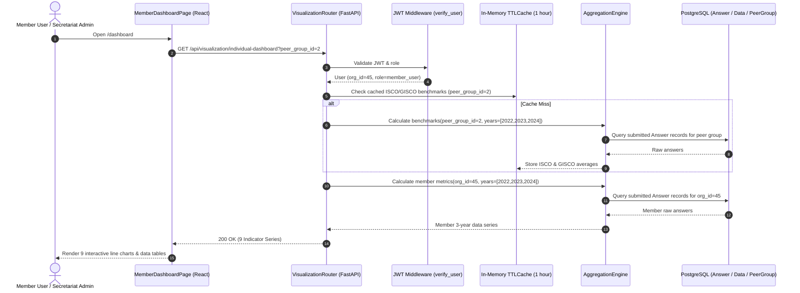

# High-Level Design (HLD): Member Reporting Back Dashboard ("Dashboard Member X")

> **Document Type**: High-Level Design (HLD)  
> **Target Audience**: GISCO Secretariat (Dr. Ulrike Joras), Platform Management (Joy Ghosh @ Akvo), Evaluators (Hilde Geens @ c-lever.org), Member Company Admins  
> **Scope**: **"Dashboard Member X" sheet** (Multi-Year Trend Dashboard: 9 Interactive Line Charts & Peer Group Selector)  
> **Status**: Ready for Google Docs Export & Partner Review  

---

## Executive Summary

The **Member Reporting Back Dashboard** digitizes the reference Excel reporting workflow (`5_Template DUMMY_Individual_reporting_back_ISCO_GISCO.xlsx`, specifically the **"Dashboard Member X"** sheet) into an interactive, role-aware analytics dashboard within the ISCO web application.

It enables member organisations to self-serve their sustainability performance over time (2022–2024) across four key challenges, benchmarked against their harmonized peer group within **GISCO** and across all **ISCO** platforms.

```text
+--------------------------------------------------------------------------------------------------------------------+
| ISCO PLATFORM                                                      [Logged in: Chocolatier AG (member_user)] [Logout]
+--------------------------------------------------------------------------------------------------------------------+
|  MEMBER REPORTING BACK DASHBOARD                                                                                   |
+--------------------------------------------------------------------------------------------------------------------+
|                                                                                                                    |
|  Individual Reporting Back Dashboard – Chocolatier Example AG                                                      |
|  Overview of performance per challenge – Member vs ISCO average over time (2022 - 2024)                             |
|                                                                                                                    |
|  [Select Peer Group: (v) Large Manufacturer ]              [Benchmark Scope: (v) GISCO (Germany) ]                 |
|                                                                                                                    |
|  +--------------------------------------------------------------------------------------------------------------+  |
|  | CHALLENGE 1: TRANSPARENCY AND TRACEABILITY                                                                   |  |
|  |                                                                                                              |  |
|  |  [ Chart 1.1: Sourced Directly (Global) ]         [ Chart 1.2: Traceable to Farm Level (Global) ]            |  |
|  |   100% |        /--o Member: 48.5%                 100% |               o Member: 47.9%                      |  |
|  |        |  o----/                                        |              /                                     |  |
|  |    50% |  ......o--o ISCO Avg: 46.5%                50% |   o----.....o  ISCO Avg: 46.7%                    |  |
|  |        |  ---------o GISCO Avg: 49.0%                   |  /--------o    GISCO Avg: 45.0%                    |  |
|  |     0% +---+----+----+                               0% +----+----+----+                                     |  |
|  |        '22 '23  '24                                     '22  '23  '24                                        |  |
|  |   Year   Member  ISCO Avg  GISCO Avg               Year   Member  ISCO Avg  GISCO Avg                        |  |
|  |   2022   34.2%    36.4%     37.0%                  2022   26.3%    28.6%     27.0%                         |  |
|  |   2023   70.6%    70.0%     65.0%                  2023   29.8%    36.3%     32.0%                         |  |
|  |   2024   48.5%    46.5%     49.0%                  2024   47.9%    46.7%     45.0%                         |  |
|  +--------------------------------------------------------------------------------------------------------------+  |
|                                                                                                                    |
|  +--------------------------------------------------------------------------------------------------------------+  |
|  | CHALLENGE 2: DEFORESTATION                                                                                   |  |
|  |  [ Chart 2.1: Deforestation-Free Cocoa (Global) ]                                                            |  |
|  +--------------------------------------------------------------------------------------------------------------+  |
|                                                                                                                    |
|  +--------------------------------------------------------------------------------------------------------------+  |
|  | CHALLENGE 3: LIVING INCOME                                                                                   |  |
|  |  [ Chart 3.1: LI Gap Measured (Global) ]           [ Chart 3.2: LI Strategy Implemented (Global) ]          |  |
|  +--------------------------------------------------------------------------------------------------------------+  |
|                                                                                                                    |
|  +--------------------------------------------------------------------------------------------------------------+  |
|  | CHALLENGE 4: CHILD LABOUR (West Africa)                                                                      |  |
|  |  [ Chart 4.1: CLMRS Coverage ]                     [ Chart 4.2: Child Labour Cases Identified (!) ]          |  |
|  |  [ Chart 4.3: Remediation Support Received ]       [ Chart 4.4: 2-Follow-Up Visits Received ]                |  |
|  +--------------------------------------------------------------------------------------------------------------+  |
+--------------------------------------------------------------------------------------------------------------------+
```

---

## 1. Core Feature Capabilities ("Dashboard Member X")

1. **Self-Service Access**: Member company admins log in and see their own organization's dashboard immediately.
2. **Secretariat Organisation Switcher**: Secretariat admins have a dropdown to inspect any member organisation's dashboard.
3. **Peer Group Benchmarking**: Dropdown selector allowing members to switch peer groups (`Trader/Processor`, `Large Manufacturer`, `SME`, `Retail`) with immediate dynamic recalculation of the benchmark lines.
4. **9 Time-Series Line Charts**: Comparing 3 curves over time (2022, 2023, 2024):
   - 🔵 **Member**: Organization's actual submitted value.
   - 🟠 **ISCO Average**: Collective peer group average across all ISCO platforms.
   - 🟢 **GISCO Average**: Peer group average within GISCO.
5. **Accompanying Data Grid**: Each chart contains a compact tabular summary beneath it showing exact yearly values.
6. **Graceful Missing Data Handling**: Missing survey years (e.g. member did not submit in 2022) render cleanly as gaps without breaking adjacent years.

---

## 2. Harmonized Peer Groups

To ensure statistically meaningful comparisons across disparate national platforms, members are categorized into four standardized peer groups:

| Peer Group | Description | Mapped Historical GISCO / ISCO Tags |
| :--- | :--- | :--- |
| **Trader/Processor** | International cocoa commodity traders and processors | `Trader GISCO`, `FRISCO-trader`, `DISCO traders`, `Trader SWISSCO` |
| **Large Manufacturer** | Multinationals and large chocolate manufacturing industries | `Industry`, `Big Industry`, `DISCO - Large Manufacturers` |
| **SME** | Small and medium enterprises, craft and specialty chocolatiers | `GISCO small industry`, `GISCO - Small Industry`, `SWISSCO SME`, `Small Industry`, `DISCO small manufacturers`, `Beyond Chocolate Small industry` |
| **Retail** | Supermarket chains, grocery retail corporations | `Retail GISCO`, `Retail SWISSCO`, `Retail FRISCO`, `Retail DISCO`, `Retail BC`, `DISCO - Retail` |

---

## 3. The 9 Core Indicators (Mapped to Survey Forms & Question Groups)

All indicators are calculated from existing questions in the **Member Questionnaire** (**Form 7** on local development and active environments, encompassing `MEMBER_SURVEY = [1, 7]`):

| Challenge | Indicator Name | Scope | Survey Form | Question Group (ID & Name) | Question IDs & Meaning | Formula |
| :--- | :--- | :--- | :--- | :--- | :--- | :--- |
| **1. Transparency & Traceability** | 1.1 Share of cocoa sourced directly | Global | Form 7 | Group 90: Sourcing & Traceability | • `ID86`: Direct sourcing volume / percentage | `ID86` |
| **1. Transparency & Traceability** | 1.2 Share of cocoa sourced traceable to farm level | Global | Form 7 | Group 90: Sourcing & Traceability | • `ID840`: Direct cocoa volume traceable to farm/polygon<br>• `ID841`: Indirect cocoa volume traceable to farm/polygon | `ID840 + ID841` |
| **2. Deforestation** | 2.1 Share of deforestation free cocoa | Global | Form 7 | Group 15: Deforestation-Free Supply Chains | • `ID851`: Volume/percentage verified deforestation-free | `ID851` |
| **3. Living Income** | 3.1 Share of households for which LI gap is measured | Global | Form 7 | Supplier Group (Repeats): Living Income Assessment | • `ID1216`: Households where LI gap is measured (in repeat groups)<br>• `ID842`: Total cocoa volume / direct supply chain households | `SUM(ID1216) / ID842` |
| **3. Living Income** | 3.2 Share of households for which LI strategy is implemented | Global | Form 7 | Supplier Group (Repeats): Living Income Assessment | • `ID847`: Households where LI strategy is applied (in repeat groups)<br>• `ID842`: Total cocoa volume / direct supply chain households | `SUM(ID847) / ID842` |
| **4. Child Labour** | 4.1 Share of households covered by CLMRS | West Africa | Form 7 | Group: Child Labour Monitoring Systems (CLMRS) | • `ID575`: Households covered by CLMRS in West Africa<br>• `ID842`: Total direct supply chain households/volume | `ID575 / ID842` |
| **4. Child Labour** | 4.2 Share of cases of child labour identified among children covered | West Africa | Form 7 | Group: Child Labour Identification & Remediation | • `ID577`: Number of child labour cases identified<br>• `ID873`: Total children monitored/covered under CLMRS | `ID577 / ID873`<br>*(Lower is better)* |
| **4. Child Labour** | 4.3 Share of children who received support among those identified | West Africa | Form 7 | Group: Remediation & Support Services | • `ID579`: Identified children who received remediation support<br>• `ID577`: Total identified child labour cases | `ID579 / ID577` |
| **4. Child Labour** | 4.4 Share of children who received 2-follow-up visits among those identified | West Africa | Form 7 | Group: Monitoring & Follow-up Verification | • `ID874`: Identified children with at least 2 follow-up visits<br>• `ID577`: Total identified child labour cases | `ID874 / ID577` |

---

## 4. Architecture & Security Flow



### Security & Privacy Invariants

1. **Tenant Isolation**: Member users are strictly restricted to their own `user.organisation_id`. Passing another organisation's ID results in `403 Forbidden`.
2. **Anonymization Threshold**: A peer group average requires **at least 3 active reporting member organisations** in that year to calculate; otherwise, the benchmark line is suppressed to prevent de-anonymization.

---

## 5. Delivery Estimation (Scoped to "Dashboard Member X")

Focused exclusively on the **"Dashboard Member X" sheet** (the 9 line charts, peer group switcher, in-memory cache, and backend aggregation engine):

- **Optimistic Dev Baseline ("Pure Vibe Coding")**: ~14.0h (2.0 days)
- **Automated Testing & TEA Coverage (≥80% gate)**: ~7.0h (1.0 day)
- **Manual QA & Verification Buffer**: ~7.0h (1.0 day)
- **Dedicated Partner Review & Feedback Buffer**: ~7.0h (1.0 day)
- **Total Duration**: **35.0 hours = Exactly 5 Working Days (1.0 Calendar Week @ 7h/day)**  
  *(Note: If a conservative 7–8 day window is desired for extensive partner deliberation, the additional 2–3 days serve as an extended feedback and data reconciliation buffer).*

---

## 6. Next Steps

1. Export this document to Google Docs for review with Dr. Ulrike Joras (GISCO) and Joy Ghosh (Akvo).
2. Proceed to implementation following the companion **LLD** and **Feature Spec**.
