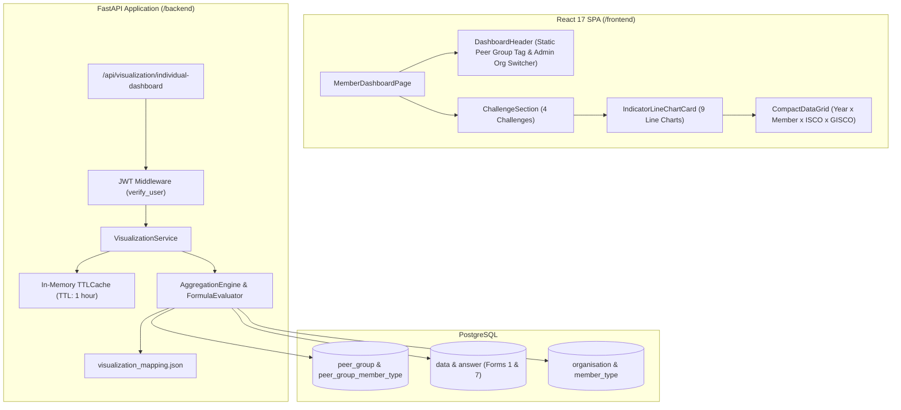
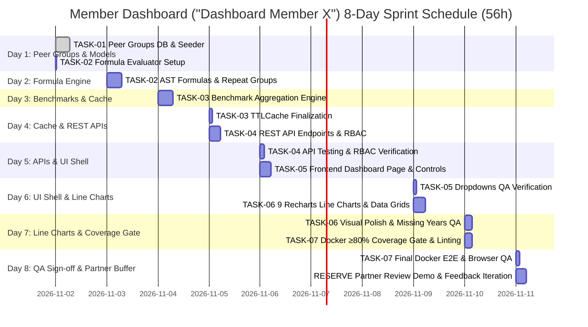

# Low-Level Design (LLD): Member Reporting Back Dashboard ("Dashboard Member X")

> **Document Type**: Low-Level Design (LLD)  
> **Target Audience**: Backend & Frontend Engineers, QA Engineers  
> **Scope**: **"Dashboard Member X" sheet** (Multi-Year Trend Dashboard: 9 Interactive Line Charts & Fixed Peer Group Benchmark)  
> **Status**: Approved for Implementation  

---

## 1. Architectural Overview & Component Hierarchy

The feature delivers an interactive time-series dashboard rendering the **9 sustainability indicators** across 4 challenges, comparing the logged-in Member against **GISCO** and **ISCO** peer group averages over years (2022, 2023, 2024).



---

## 2. Database Schema & Migration

### 2.1 SQLAlchemy Models (`/backend/models/peer_group.py`)

```python
from sqlalchemy import Column, Integer, String, Text, ForeignKey, DateTime
from sqlalchemy.orm import relationship
from datetime import datetime
from db.connection import Base
from models.member_type import MemberType


class PeerGroup(Base):
    __tablename__ = "peer_group"

    id = Column(Integer, primary_key=True, index=True, autoincrement=True)
    name = Column(String, nullable=False)
    code = Column(String, unique=True, index=True, nullable=False)
    description = Column(Text, nullable=True)
    created = Column(DateTime, default=datetime.utcnow)

    member_types = relationship(
        "PeerGroupMemberType",
        backref="peer_group_detail",
        cascade="all, delete-orphan",
    )


class PeerGroupMemberType(Base):
    __tablename__ = "peer_group_member_type"

    id = Column(Integer, primary_key=True, index=True, autoincrement=True)
    peer_group_id = Column(Integer, ForeignKey("peer_group.id", ondelete="CASCADE"), nullable=False)
    member_type_id = Column(Integer, ForeignKey("member_type.id", ondelete="CASCADE"), nullable=False)
    isco_scope = Column(String, default="ALL", nullable=False)  # 'GISCO', 'ISCO', or 'ALL'

    member_type_detail = relationship(MemberType, backref="peer_group_associations")
```

### 2.2 Seeder Mapping
Alembic migration creates the tables and seeds 4 harmonized peer groups linked to existing `member_type` tags:
- `trader_processor`: Trader GISCO, FRISCO-trader, DISCO traders, Trader SWISSCO
- `large_manufacturer`: Industry, Big Industry, DISCO - Large Manufacturers
- `sme`: GISCO small industry, GISCO - Small Industry, SWISSCO SME, Small Industry, DISCO small manufacturers, Beyond Chocolate Small industry
- `retail`: Retail GISCO, Retail SWISSCO, Retail FRISCO, Retail DISCO, Retail BC, DISCO - Retail

---

## 3. Declarative Configuration: `visualization_mapping.json`

**Path**: `/backend/source/config/visualization_mapping.json`

```json
{
  "challenges": [
    {
      "id": "transparency_and_traceability",
      "name": "Transparency and traceability",
      "indicators": [
        {
          "id": "sourced_directly",
          "name": "Share of cocoa sourced directly",
          "country": "Global",
          "form_id": 7,
          "question_group": { "id": 90, "name": "Sourcing & Traceability" },
          "formula": "ID86",
          "numerator_ids": [86],
          "denominator_ids": [],
          "type": "percentage",
          "higher_is_better": true
        },
        {
          "id": "sourced_traceable",
          "name": "Share of cocoa sourced traceable to farm level",
          "country": "Global",
          "form_id": 7,
          "question_group": { "id": 90, "name": "Sourcing & Traceability" },
          "formula": "ID840 + ID841",
          "numerator_ids": [840, 841],
          "denominator_ids": [],
          "type": "percentage",
          "higher_is_better": true
        }
      ]
    },
    {
      "id": "deforestation",
      "name": "Deforestation",
      "indicators": [
        {
          "id": "deforestation_free",
          "name": "Share of deforestation free cocoa",
          "country": "Global",
          "form_id": 7,
          "question_group": { "id": 15, "name": "Deforestation-Free Supply Chains" },
          "formula": "ID851",
          "numerator_ids": [851],
          "denominator_ids": [],
          "type": "percentage",
          "higher_is_better": true
        }
      ]
    },
    {
      "id": "living_income",
      "name": "Living income",
      "indicators": [
        {
          "id": "li_gap_measured",
          "name": "Share of households in direct supply chain for which a LI gap is measured",
          "country": "Global",
          "form_id": 7,
          "question_group": { "id": "supplier_repeats", "name": "Supplier Repeat Group - Living Income" },
          "formula": "ID1216 / ID842",
          "numerator_ids": [1216],
          "denominator_ids": [842],
          "aggregate_repeats": true,
          "type": "ratio",
          "higher_is_better": true
        },
        {
          "id": "li_strategy_implemented",
          "name": "Share of households in direct supply chain for which a LI strategy is implemented",
          "country": "Global",
          "form_id": 7,
          "question_group": { "id": "supplier_repeats", "name": "Supplier Repeat Group - Living Income" },
          "formula": "ID847 / ID842",
          "numerator_ids": [847],
          "denominator_ids": [842],
          "aggregate_repeats": true,
          "type": "ratio",
          "higher_is_better": true
        }
      ]
    },
    {
      "id": "child_labour",
      "name": "Child Labour",
      "indicators": [
        {
          "id": "clmrs_covered",
          "name": "Share of households in supply chain covered by CLMRS",
          "country": "West Africa (Cameroon, Côte d'Ivoire, Ghana, Nigeria)",
          "form_id": 7,
          "question_group": { "id": "clmrs_monitoring", "name": "Child Labour Monitoring Systems (CLMRS)" },
          "formula": "ID575 / ID842",
          "numerator_ids": [575],
          "denominator_ids": [842],
          "type": "ratio",
          "higher_is_better": true
        },
        {
          "id": "child_labour_identified",
          "name": "Share of cases of child labour identified among children covered",
          "country": "West Africa (Cameroon, Côte d'Ivoire, Ghana, Nigeria)",
          "form_id": 7,
          "question_group": { "id": "clmrs_identification", "name": "Child Labour Identification & Remediation" },
          "formula": "ID577 / ID873",
          "numerator_ids": [577],
          "denominator_ids": [873],
          "type": "ratio",
          "higher_is_better": false
        },
        {
          "id": "support_received",
          "name": "Share of children who received support among those identified",
          "country": "West Africa (Cameroon, Côte d'Ivoire, Ghana, Nigeria)",
          "form_id": 7,
          "question_group": { "id": "clmrs_remediation", "name": "Remediation & Support Services" },
          "formula": "ID579 / ID577",
          "numerator_ids": [579],
          "denominator_ids": [577],
          "type": "ratio",
          "higher_is_better": true
        },
        {
          "id": "follow_up_visits",
          "name": "Share of children who received 2-follow-up visits among those identified in child labour",
          "country": "West Africa (Cameroon, Côte d'Ivoire, Ghana, Nigeria)",
          "form_id": 7,
          "question_group": { "id": "clmrs_followup", "name": "Monitoring & Follow-up Verification" },
          "formula": "ID874 / ID577",
          "numerator_ids": [874],
          "denominator_ids": [577],
          "type": "ratio",
          "higher_is_better": true
        }
      ]
    }
  ]
}
```

---

## 4. REST API Contract

### `GET /api/visualization/individual-dashboard`

**Query Parameters**:
- `organisation_id` (optional, integer): Target organisation. Restricted to `secretariat_admin`. Defaults to caller's organisation.
- `isco_id` (optional, integer): Baseline ISCO scope (defaults to GISCO = 1).

**Success Response (`200 OK`)**:
```json
{
  "organisation": {
    "id": 45,
    "name": "Chocolatier Example AG",
    "peer_group": {
      "id": 2,
      "code": "large_manufacturer",
      "name": "Large Manufacturer"
    }
  },
  "years": [2022, 2023, 2024],
  "challenges": [
    {
      "id": "transparency_and_traceability",
      "name": "Transparency and traceability",
      "indicators": [
        {
          "id": "sourced_directly",
          "name": "Share of cocoa sourced directly",
          "country": "Global",
          "unit": "percentage",
          "chart_type": "line",
          "higher_is_better": true,
          "series": [
            { "year": 2022, "member": 0.3422, "isco_avg": 0.3640, "gisco_avg": 0.3700 },
            { "year": 2023, "member": 0.7056, "isco_avg": 0.7000, "gisco_avg": 0.6500 },
            { "year": 2024, "member": 0.4854, "isco_avg": 0.4650, "gisco_avg": 0.4900 }
          ]
        },
        {
          "id": "sourced_traceable",
          "name": "Share of cocoa sourced traceable to farm level",
          "country": "Global",
          "unit": "percentage",
          "chart_type": "line",
          "higher_is_better": true,
          "series": [
            { "year": 2022, "member": 0.2629, "isco_avg": 0.2860, "gisco_avg": 0.2700 },
            { "year": 2023, "member": 0.2979, "isco_avg": 0.3630, "gisco_avg": 0.3200 },
            { "year": 2024, "member": 0.4786, "isco_avg": 0.4670, "gisco_avg": 0.4500 }
          ]
        }
      ]
    }
  ]
}
```

---

## 5. Calculation Logic & Caching Engine

1. **Formula Evaluation & AST Permutations**:
   - Built on safe Python `ast` syntax parser supporting arbitrary arithmetic (`+`, `-`, `*`, `/`), nested parentheses `(A + B) / C`, repeat sums (`SUM(ID1216) / ID842`), and statistical/fallback functions (`AVG`, `MIN`, `MAX`, `COALESCE`).
   - `ID86`: direct lookup from submitted Answer.
   - `ID840 + ID841`: summation of direct and indirect traceable volumes.
   - `SUM(ID1216) / ID842`: sums numerator values across all repeat group entries, guarded against division-by-zero (`null` if denominator is 0).
2. **Missing Years**: If an organisation did not submit data for a given year (e.g. 2022), `member: null` is emitted. Recharts renders this as a non-connected gap.
3. **Configurable Exclusion of Active Member (`exclude_current_member_from_average`)**:
   - Declarative setting (in `visualization_mapping.json` or `.env`, default `false`).
   - If enabled, the engine subtracts the active member's values from the cached cohort aggregate in $O(1)$ time, maintaining `< 50ms` response times while enabling clean self-exclusion.
4. **In-Memory TTL Caching**:
   - Peer group averages (`ISCO_Average` and `GISCO_Average`) are calculated across all submitted member answers and cached in an in-memory `TTLCache` (TTL: 1 hour) keyed by `peer_group_id`.
   - Repeated requests hit cache in `< 50ms`.

---

## 6. Frontend UI Component Specifications

- **Page Entrypoint**: `/frontend/src/pages/member-dashboard/MemberDashboardPage.jsx`
- **Routing**: Accessible at `/dashboard` from the top header navigation.
- **Charts Library**: **`akvo-charts`** (`Line` component powered by Apache ECharts):
  - Component: `import { Line } from 'akvo-charts';`
  - Style: `import 'akvo-charts/dist/index.css';`
- **Styling**: ISCO palette:
  - 🔵 Member Line: `#1890ff` (solid stroke 3px, circular symbol)
  - 🟠 ISCO Average Line: `#fa8c16` (dashed stroke 2px, square symbol)
  - 🟢 GISCO Average Line: `#52c41a` (dotted stroke 2px, triangle symbol)
- **Data Grid**: Compact Ant Design HTML table below each chart with columns `Year`, `Member`, `ISCO Avg`, `GISCO Avg`.

---

## 7. Engineering Estimation Breakdown & Sprint Schedule (1 Dev, 52.0 Hours / ~7.4 Days)

### 7.1 Estimation Methodology
- **Developer Capacity**: 1 full-stack engineer working **7 productive hours per day**, 5 days per week.
- **Buffer Allocation**: Each engineering task includes a **+1.0h to +2.0h buffer for manual browser QA and edge-case testing**, ensuring no task is under-estimated.
- **Dedicated Partner Review Reserve**: 5.5 hours (~0.8 working days) are explicitly reserved for review walkthroughs with GISCO and Akvo stakeholders.

### 7.2 Granular Task Estimation Breakdown

| Task ID | Task Description & Subtasks | Vibe Coding (Dev) | Automated Testing | Manual QA & +1h Buffer | Total Buffered | Working Days (7h/d) |
| :--- | :--- | :---: | :---: | :---: | :---: | :---: |
| **TASK-01** | **Harmonized Peer Groups Database & Seeder**<br>• Create `peer_group` and `peer_group_member_type` SQLAlchemy models<br>• Write Alembic migration script with table constraints and indexes<br>• Seed 4 harmonized peer groups linked to existing `member_type` tags (`Trader/Processor`, `Large Manufacturer`, `SME`, `Retail`)<br>• Write database unit tests verifying tag mapping and migration upgrade/downgrade | 3.0h | 1.5h | 2.0h | **6.5h** | ~0.9d |
| **TASK-02** | **Declarative Indicator Configuration & AST Formula Evaluator**<br>• Author `/backend/source/config/visualization_mapping.json` for 9 indicators with `chart_type: "line"`<br>• Implement safe Python AST formula evaluator supporting arithmetic (`+`, `-`, `*`, `/`), nested groupings `(A + B) / C`, repeat sums (`SUM(ID1216) / ID842`), and custom permutations (`AVG`, `MIN`, `MAX`, `COALESCE`)<br>• Add division-by-zero & missing data safeguards (returns `null` without 500)<br>• Unit test evaluator against mock survey payloads across complex permutation edge cases | 3.5h | 2.0h | 2.0h | **7.5h** | ~1.1d |
| **TASK-03** | **Peer Group Benchmark Aggregation Engine & In-Memory TTLCache**<br>• Implement query logic to extract submitted answers for peer group member organisations across 2022–2024<br>• Calculate GISCO Average and ISCO Average benchmarks for the peer group cohort<br>• Implement configurable member self-exclusion toggle (`exclude_current_member_from_average`) with $O(1)$ cached cohort subtraction<br>• Enforce minimum cohort gate (>=3 reporting members per peer group/year to prevent de-anonymization)<br>• Build in-memory `TTLCache` (1-hour TTL) keyed by `peer_group_id`<br>• Integration tests verifying benchmark calculation & cache hits with and without member exclusion | 3.5h | 2.0h | 2.0h | **7.5h** | ~1.1d |
| **TASK-04** | **Individual Dashboard REST API Endpoints & Multi-Tenant RBAC**<br>• Implement `GET /api/visualization/individual-dashboard` endpoint<br>• Enforce automatic peer group resolution from member's `member_type`<br>• Enforce data isolation: `member_user` can only query own organisation<br>• Enable Secretariat Admin switcher (`?organisation_id={id}`)<br>• API integration tests verifying RBAC, 403 Forbidden on foreign org, and missing year handling (`null` data points) | 3.0h | 2.0h | 1.5h | **6.5h** | ~0.9d |
| **TASK-05** | **Frontend Dashboard Page Shell & Dynamic Controls**<br>• Create `/frontend/src/pages/member-dashboard/MemberDashboardPage.jsx`<br>• Add top header navigation link to `/dashboard`<br>• Render static Peer Group tag/badge based on API response<br>• Implement Secretariat Organisation Switcher dropdown for `secretariat_admin`<br>• Handle loading spinners, error boundaries, and empty state alerts | 2.5h | 1.5h | 1.5h | **5.5h** | ~0.8d |
| **TASK-06** | **9 Multi-Line Charts via `akvo-charts` & Accompanying Data Grids**<br>• Install & verify `akvo-charts` in frontend (`./dc.sh exec frontend yarn add akvo-charts`)<br>• Build `IndicatorLineChartCard.jsx` using `akvo-charts` `<Line>` component<br>• Configure 3 distinct curves: Member (solid blue), ISCO Avg (dashed orange), GISCO Avg (dotted green)<br>• Handle inverted polarity for child labour identification (lower is better visual cues)<br>• Render non-connected gaps for missing years (`null` points)<br>• Build compact yearly data table below each chart (`Year`, `Member`, `ISCO Avg`, `GISCO Avg`)<br>• Responsive 2-column grid layout across 4 Challenge sections | 4.5h | 2.0h | 2.5h | **9.0h** | ~1.3d |
| **TASK-07** | **E2E Integration, Docker Coverage Gate & Partner Feedback Buffer**<br>• Full regression run inside Docker (`./dc.sh exec backend ./test.sh`) enforcing **≥80% test coverage**<br>• Backend linting (`flake8`) and frontend linting/formatting (`yarn lint`, `yarn prettier-write`)<br>• Cross-browser testing (Chrome, Firefox, Safari) and responsive layout validation<br>• Walkthrough review demo with Joy Ghosh (Akvo) and Dr. Ulrike Joras (GISCO)<br>• Dedicated buffer for stakeholder adjustments and formula calibration | 2.5h | 1.5h | 5.5h | **9.5h** | ~1.4d |
| **TOTAL** | **Full Feature Delivery ("Dashboard Member X" Sheet)** | **22.5h** | **12.5h** | **17.0h** | **52.0h** | **~7.4 Working Days** |

---

### 7.3 Optimistic vs. Calibrated Buffered Estimate Comparison

| Component | Optimistic ("Vibe Coding") | Calibrated Buffered Plan | Difference (Buffer) | Rationale |
| :--- | :---: | :---: | :---: | :--- |
| **Core Dev Implementation** | 16.5h | 22.5h | +6.0h | Accounts for real-world AST edge cases, repeat group handling, and responsive styling. |
| **Automated Testing (TEA)** | 7.5h | 12.5h | +5.0h | Guarantees meeting the strict ≥80% test coverage gate inside Docker (`./dc.sh`). |
| **Manual QA & Verification** | 4.0h | 11.5h | +7.5h | Adds +1.0h to +2.0h per task for manual browser inspection and Excel reconciliation. |
| **Partner Review Reserve** | 0.0h | 5.5h | +5.5h | Explicit buffer for review demos with GISCO/Akvo and requested formula adjustments. |
| **Total Effort** | **28.0h (~4.0 days)** | **52.0h (~7.4 days)** | **+24.0h (+3.4 days)** | **Provides realistic, stress-free delivery without risk of scope or deadline slip.** |

---

### 7.4 8-Day Delivery Gantt Schedule (1 Dev, 7h/day)



